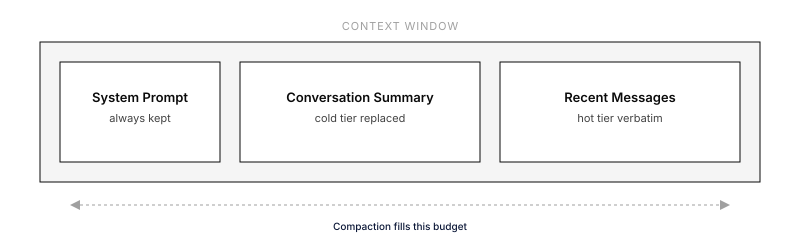
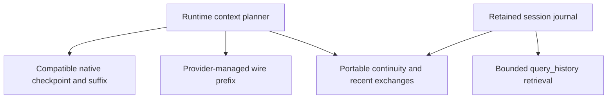
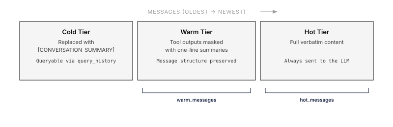

Long-running agent sessions accumulate more history than a model can use effectively. **Context compaction** keeps a bounded working context, durable continuity and access to older evidence. Summaries are lossy, so the retained journal remains the source for verifying details.

Everruns provides multiple compaction strategies that can be combined. The default `auto` strategy selects provider-native compaction when supported and portable continuity on local paths, with cheap masking and overflow recovery where appropriate.



## How It Works

Enable `compaction` as the single capability for managed long-session context:

```json
{
  "capabilities": [
    {
      "ref": "compaction",
      "config": {
        "strategy": "auto",
        "context_budget_tokens": 64000
      }
    }
  ]
}
```

It includes `query_history` for retrieving older evidence when permitted. Raw
session events remain unchanged. `infinity_context` is a deprecated compatibility
entry; new configurations do not need to list both capabilities. Used alone, the
legacy entry retains its trimming behavior and does not enable paid summaries.

## Working context and continuity

The working-history target is independent of the model's maximum context window.
A larger model window does not mean the whole conversation should be sent every
time. Current instructions and tools are assembled separately; the runtime also
reserves output capacity and applies the provider's hard limit.

On local `auto` or `summarization` paths with checkpoint storage, proactive
compaction folds contiguous journal pages into an encrypted, durable portable
summary and keeps a recent tail of complete tool exchanges. A successful summary
replaces an exact prefix. Later turns and restarted workers restore that summary
plus messages after its boundary. Compaction never treats an omitted loading
window as summarized history.

Portable summaries retain provenance, unresolved questions and later corrections.
Activated skill instructions are carried verbatim outside generated prose.
Generated continuity is reference material, not permission to change current
instructions. A summary can still lose details: use `query_history` to verify
claims or recover source evidence. Search returns message IDs that can be fetched
with `message_id`; `message_range` retrieves a bounded absolute range.

Source user requirements are passed to the summarizer in full, within the source-page budget. Long reproducible observations may be clipped with explicit omission markers.

Summary generation is a separate, paid model call recorded in the trace and
usage totals. Empty, truncated and tool-calling responses are rejected. Completed
candidates are saved before installation, so retrying the same source after an
installation failure can reuse the candidate. Messages arriving during a summary
remain in the raw suffix. The first compaction of an existing large session can
require several calls; subsequent calls process new history incrementally.

## Triggers and provider modes

Compaction operates at two points:

1. **Proactively**: local continuity follows `context_budget_tokens` (default 64,000 history tokens), with room reserved for output. The final request check also considers tools and instructions against the provider window. Native compaction uses `budget_percent` (default 85%) and current-history pressure. This can avoid a failed request.

2. **Reactively**: if the LLM still returns a `RequestTooLarge` error (estimation can undercount), the compaction cascade runs and the request is retried automatically.

The proactive estimate includes the schemas offered to the model, not just messages.
Deferred tools contribute their visible schema stubs, not the private full schemas
kept for later discovery. History trimming reserves room for those declarations
and system instructions. If that fixed input alone reaches the estimated context
window, the request fails explicitly: reduce active schemas or instructions, or
choose a larger-context model. Removing conversation history cannot fix it.

Estimates use bytes divided by four, including the larger strict-schema shape
where applicable; they are not provider token counts. Cache-stable tool epochs
also reserve room for replayed schema changes. Under pressure Everruns can restart
the declaration epoch with the current catalog before trimming history. Provider
wrappers, hosted tools and opaque checkpoints can still change actual usage, so
reactive overflow recovery remains necessary.

Provider-native epochs preserve their required replay representation. Local strategies use portable continuity when available; reactive overflow recovery remains a final safety net:



The UI shows a divider between messages whenever compaction happens:

> **Context compacted** · 90.7K → 51.6K estimated tokens · masking

The divider prefers token measurements when available. Masking can reduce tokens while retaining every message; unchanged message counts do not indicate failure. Counts may be estimates and can differ from provider usage. Click the divider for strategy and timing details.

## Strategies

### Auto (default)

Selects a supported native mode, or local portable continuity with cheap masking. This is the recommended setting for most use cases.

### Observation Masking

Replaces old tool outputs with compact summaries while keeping the message structure intact. This is free (no LLM call) and preserves tool call IDs for tracing.

Two summary formats:

| Format | Example | When to use |
|---|---|---|
| `one_line` (default) | `[read_file → 47 lines, 2340 bytes]` | Most cases, minimal footprint |
| `head_tail` | First 3 lines + `... (14 lines omitted) ...` + last 3 lines | When partial output context helps |

The most recent N tool outputs are kept verbatim (default: 2). Runtime masking advances in batches, skips small outputs and only reports effective reductions. Reapplying a masked view is not an additional model call.

### Native Provider Compaction

Delegates compaction to the LLM provider's own endpoint. Currently supported by OpenAI's Responses API (`/responses/compact`). When available, this can be more intelligent than generic strategies since the provider understands its own tokenization. Everruns sends either a stateful response handle or a standalone transcript to the compact endpoint, never both. The returned ordered context is encrypted at rest as a durable checkpoint and reused across later turns and process restarts. Each request combines the latest checkpoint for the exact provider/model with raw messages written after its source boundary; changing provider or model can restore a portable checkpoint, or rebuild from the retained journal when none exists.

Compaction never deletes or rewrites session events. Public `context.compacted` events contain only counts, timing, strategy, and an optional checkpoint identifier. Provider-native encrypted context remains confined to the internal provider and storage paths.

### Summarization

Uses an LLM to generate a structured summary of older messages. The summary replaces those messages in context and is wrapped in `[CONVERSATION_SUMMARY]` tags so subsequent compactions can re-summarize it.

Local summaries distinguish user requirements from instructions embedded in tool results or fetched material. They retain the source and basis of unresolved claims, explicit user adoption, and later confirmations or corrections through repeated summaries. Active Skills remain verbatim. These are summarizer instructions, not a guarantee of factual accuracy; native provider compaction is unchanged.

You can configure:
- Which model to use through the current provider (default: same as the agent)
- What information to preserve (decisions, files modified, errors, etc.)
- Custom instructions appended to the summarization prompt

### Aggressive Trim

Legacy and request-local recovery paths can drop the oldest messages to fit a token budget while preserving system instructions and recent messages. This is lossy for the active prompt. It does not establish a portable continuity checkpoint or delete journal events. Managed portable recovery advances a validated summary boundary instead; if it cannot safely advance, the original overflow remains an error.

## Worker Harness Defaults

The built-in **Worker** harness inherits `compaction` with automatic proactive
reduction. It includes history retrieval through its compatibility dependency;
you do not need a separate `infinity_context` entry.

The planner selects a provider-compatible native checkpoint when available.
Otherwise, a validated portable checkpoint can be used with another model or
provider. Opaque native content is never translated or sent across provider/model
boundaries. When no portable checkpoint exists, a local path can build one from
the retained journal; this has an initial summarization cost.

In `auto`, a compatible native checkpoint whose serialized footprint exceeds the
working target can also start a new portable epoch from the journal. This is a
size heuristic, not a provider token measurement. Use `native` to keep explicit
provider-native compaction without that local transition.

Eligible Anthropic models can use provider-managed compaction. Within that epoch,
Everruns preserves the required wire prefix and disables competing local masking
and trimming. Provider-side context reduction does not necessarily reduce HTTP
request bytes. Native checkpoints remain provider/model/format specific.

`query_history` is disabled when provider-bound prompt hooks make raw-history
retrieval unsafe. Portable journal summaries are also disabled at that boundary.
Stored audit history is never a route around prompt filtering.


## Configuration

Compaction is a capability configured per agent or harness via `AgentCapabilityConfig`.

### Default (auto strategy, proactive)

```json
{
  "capabilities": ["compaction"]
}
```

### Custom strategy and budget

```json
{
  "capabilities": [
    {
      "ref": "compaction",
      "config": {
        "strategy": "auto",
        "proactive": true,
        "budget_percent": 0.85
      }
    }
  ]
}
```

### Observation masking only (no LLM calls)

```json
{
  "capabilities": [
    {
      "ref": "compaction",
      "config": {
        "strategy": "observation_masking",
        "observation_masking": {
          "keep_recent_tool_outputs": 10,
          "summary_format": "head_tail"
        }
      }
    }
  ]
}
```

### Summarization with a cheaper model

```json
{
  "capabilities": [
    {
      "ref": "compaction",
      "config": {
        "strategy": "summarization",
        "summarization": {
          "model": "claude-haiku-4-5-20251001",
          "preserve": ["decisions", "files_modified", "errors", "api_keys"],
          "instructions": "Focus on architecture decisions and API contract changes"
        }
      }
    }
  ]
}
```

### Full configuration with memory tiers

```json
{
  "capabilities": [
    {
      "ref": "compaction",
      "config": {
        "strategy": "auto",
        "proactive": true,
        "budget_percent": 0.80,
        "observation_masking": {
          "keep_recent_tool_outputs": 5,
          "summary_format": "one_line"
        },
        "summarization": {
          "model": null,
          "preserve": ["decisions", "files_modified", "errors", "current_plan"],
          "instructions": null
        },
        "memory_tiers": {
          "hot_messages": 20,
          "warm_messages": 100
        }
      }
    }
  ]
}
```

## Configuration Reference

### Top-level

| Field | Type | Default | Description |
|---|---|---|---|
| `strategy` | string | `"auto"` | Compaction strategy: `auto`, `native`, `observation_masking`, or `summarization` |
| `proactive` | boolean | `true` | Compact before hitting context limits (recommended) |
| `context_budget_tokens` | integer | `64000` | Working-history target, minimum 4096; hard provider limits still apply |
| `budget_percent` | float | `0.85` | Trigger proactive compaction at this fraction of the context window |

For `auto` and `native`, proactive pressure invokes provider-native compaction
when the driver supports it and stores the result as a durable checkpoint. The
driver's effective model context window takes precedence over the built-in
profile, so external drivers can report their actual limit. Stateful
`previous_response_id` requests skip local proactive pressure checks because
their request body is only a delta over provider-held context; reactive
too-large recovery remains available.

A native result must materially reduce provider-reported tokens, or serialized
bytes when token usage is unavailable: at least 5%, with a 32-unit floor for
small measurements. Smaller results do not install or replace a checkpoint and
do not emit `context.compacted`. A newly installed checkpoint
is not proactively replaced again until a meaningful raw-message suffix has
accumulated. Failed and no-op native attempts are also held behind a retry
watermark until estimated input grows by both 4,096 tokens and 5%, avoiding
repeated compact calls against the same source. Branch and rollback selection
ignore watermarks from a different transcript lineage. When it is re-armed, the
next native compact request preserves the
prior opaque checkpoint items in order before appending that suffix, for both
proactive and reactive compaction.

### Observation Masking

| Field | Type | Default | Description |
|---|---|---|---|
| `keep_recent_tool_outputs` | integer | `2` | Number of recent tool outputs to keep verbatim |
| `summary_format` | string | `"one_line"` | How to summarize masked outputs: `one_line` or `head_tail` |

### Summarization

| Field | Type | Default | Description |
|---|---|---|---|
| `model` | string \| null | `null` | Model for summarization. Null = same as the agent's model |
| `preserve` | string[] | `["decisions", "files_modified", "errors", "current_plan", "skill_instructions"]` | Information categories to preserve in summaries |
| `instructions` | string \| null | `null` | Custom instructions appended to the summarization prompt |

### Memory Tiers

| Field | Type | Default | Description |
|---|---|---|---|
| `hot_messages` | integer | `20` | Recent messages kept verbatim (full content) |
| `warm_messages` | integer | `100` | Older messages with observation masking applied to tool outputs |

These counts are retained for compatibility with the memory-tier helpers. They do not set the durable portable checkpoint boundary. The managed planner uses the token target, exact journal sequences and complete tool exchanges. Older evidence stays queryable through the retrieval included by `compaction`, when permitted.

## Memory Tier Diagram



## Combining with Infinity Context

New configurations enable only `compaction`. Existing configurations that explicitly list both remain supported:

```json
{
  "capabilities": [
    "infinity_context",
    {
      "ref": "compaction",
      "config": {
        "strategy": "auto",
        "proactive": true
      }
    }
  ]
}
```

An explicit legacy `infinity_context.context_budget_tokens` setting can lower the
effective working target when both are present. Remove the legacy entry and set
the desired target on `compaction` when migrating. The internal compatibility
dependency provides retrieval and bounded bootstrap loading; it is not a second
independent checkpoint reducer.

## Events

Compaction emits SSE lifecycle and result events:

| Event | When | Key fields |
|---|---|---|
| `context.compacting` | Semantic compaction starts | `reason` (proactive_budget, request_too_large, manual), `strategy`, `messages_before`, optional `tokens_before` / `bytes_before` |
| `context.compacted` | Material semantic reduction completes | `strategy_used`, `messages_before`, `messages_after`, optional before/after token or byte metrics, `duration_ms`, `steps[]`, optional `checkpoint_id` |
| `context.compaction.skipped` | A native attempt cannot safely install a reduction | Reason, strategy and pressure measurements |
| `context.compaction.failed` | A native compaction operation fails | Stage, error and pressure measurements |

Each step in the cascade is recorded with its strategy name, resulting message count, and duration.
Provider-encrypted native compact content is never included in these public events.
Request-local masking may emit a `context.compacted` measurement when it reduces
the estimated prompt size; that event alone does not establish a durable checkpoint.
Portable summary generation also emits a separate `llm.generation` usage event
with request metadata `purpose: continuity_summary`.

## Best Practices

- **Start with defaults.** The `auto` strategy with `proactive: true` handles most cases well.
- **Lower `budget_percent`** (e.g., 0.70) if your agents use large tool outputs frequently, this gives more headroom before the context fills.
- **Increase `keep_recent_tool_outputs`** if your agent often references recent tool results across multiple turns.
- **Use a cheaper model for summarization** (e.g., Haiku) to reduce cost and latency when the summarization step runs.
- **Set a working target** with `context_budget_tokens` for sessions that run for hours or days; keep history retrieval available for evidence.
- **Customize `preserve`** to match your agent's domain, if your agent tracks database schemas or API contracts, add those to the preserve list.

## See Also

- [Infinity Context](/capabilities/infinity-context/), Message history windowing and retrieval
- [Capabilities Overview](/capabilities/), How capabilities are configured
- [Harnesses](/features/harnesses/), Where capability configs are applied
- [Events](/features/events/), SSE event streaming reference
