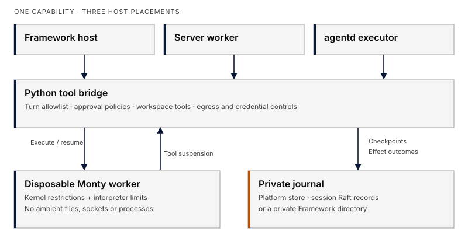
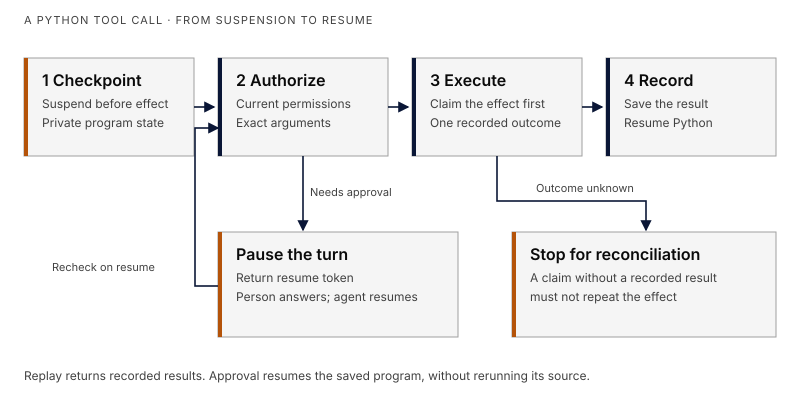

Python Code Mode adds the `python` tool, backed by [Monty](https://github.com/pydantic/monty).
Choose it when you want the agent to write Python programs that orchestrate its
existing tools and can suspend at an approval boundary. Both Everruns Framework
and Server support this option; agentd runs it on executors.

| | |
|---|---|
| Capability | `python_code_mode` |
| Cargo feature | `monty` on `everruns`, `everruns-server`, `everruns-worker`, or `everruns-agentd` |
| Category / risk | Execution / High |
| Runtime | Monty **1.5.0**, disposable subprocesses |
| Default launcher | `/usr/local/bin/everruns-monty-worker` |

Bashkit already supports Python. The reason to choose Monty is its **Python tool
interface and suspended-program continuation**, not access to the Python
language. See [choosing execution options](/framework/execution-options/) before
adding another runtime.



## Enable it

On Server or agentd, build the executing host with `--features monty`, install
the worker described below, and add this entry to the agent's capabilities:

```json
{
  "capabilities": [{ "ref": "python_code_mode" }]
}
```

For Framework applications, attach `PythonCodeMode` as shown in the
[Framework guide](/framework/python-code-mode/). Attach workspace and network
capabilities separately when the agent needs those operations.

## Use the tool

Start a program with `script`:

```json
{
  "script": "squares = [n * n for n in range(1, 13)]\nprint(squares)\nsum(squares)"
}
```

The final expression becomes `result`; printed text becomes `stdout`.
Each fresh script has fresh interpreter state. State is retained only by a
continuation for that program, not as a shared Python REPL between tool calls.

Two host functions are available:

| Function | Result |
|---|---|
| `tools()` | Current eligible tool schemas, with a `truncated` flag |
| `tools("file")` | Schemas whose names contain the query |
| `tool("name", {"argument": "value"})` | `{"result": ..., "error": ...}` after the tool's policy hooks |

Use positional arguments. Inspect `error` before using a result. Inputs and
results are JSON values; object keys must be strings, integers must fit signed
64 bits, and cycles, non-finite floats and opaque Python objects are rejected.

```python
catalog = tools("file")
catalog
```

Then use the discovered schemas for workspace operations. Network requests go
through attached tools such as `web_fetch`, with their normal egress policy,
SSRF protection, credential bindings and response filtering. Python receives
only the tool's filtered result. The bridge supplies disabled egress when a
host omitted its egress service; it cannot select a standalone direct transport.

There are no host mounts or raw Python sockets. `open`, host imports,
subprocesses, pip and arbitrary third-party Python packages are unavailable.
Use the workspace tools for files. Monty implements a Python subset; it is not
a general CPython installation.

## Approval and durable resume

Before a nested call, Everruns saves the suspended program in private host
storage. The nested call passes through the same pre-tool and approval policy
as a direct call. A call needing approval produces the normal approval request
and a `python_resume` token. After the person answers, the agent resumes with:

```json
{
  "resume": "<python_resume token from the paused result>"
}
```

Supply **exactly one** of `script` or `resume`. Resume continues the saved
program at the pending call. It rechecks the current tool allowlist and policy;
an approval is neither permanent permission nor permission for different
arguments. Rejection cannot execute the pending effect. The model must issue
the resume call after the decision; the engine does not silently rerun source.



The effect journal records each nested result before giving it to Python.
Recorded effects are replayed as results. A claimed effect without a recorded
outcome is **not repeated**, even for a nominally read-only tool: its outcome
must be reconciled. This is conservative recovery, not an exactly-once promise
about external services. A completed continuation returns its recorded result.

Continuations are scoped to the session and active input/turn. They are not
portable files or model-supplied snapshots. The current worker/adapter version
must match; upgrading it does not migrate old snapshots automatically.

## Install and operate

Install the pinned runtime and the matching Everruns launcher beside each other:

```bash
export MONTY_INSTALL_ROOT=/opt/everruns/monty
cargo install monty-runtime --version 1.5.0 --locked --root "$MONTY_INSTALL_ROOT"
cargo install everruns-integrations --features monty \
  --bin everruns-monty-worker --root "$MONTY_INSTALL_ROOT"
export EVERRUNS_MONTY_BIN="$MONTY_INSTALL_ROOT/bin/everruns-monty-worker"
```

Use the Everruns integration version matching your application. Install on the
machines that execute turns: Framework hosts, workers, and agentd executors
(including the executor in standalone `agentd serve`). A control-plane-only
server or Raft-only shard does not execute Python. This opt-in feature and its
runtime are not added to the standard release images automatically; build the
host with `--features monty` and include both binaries in its image.

The hardened launcher requires **Linux with Landlock ABI 3 or newer and
seccomp**. It restricts file reads to the runtime and shared libraries, denies
filesystem writes, sockets, new processes and process inspection, clears the
environment, and sets kernel memory/CPU/descriptor limits. It fails closed if
these controls are unavailable. The interpreter also has its own limits.
There is no automatic fallback to Bashkit, a host shell or a remote service.

An advanced host can set `MontyConfig.binary` to a trusted alternate launcher.
Pointing it directly at `monty` provides interpreter/process isolation but
omits Everruns' kernel boundary; use that only under an independently hardened
execution host. Model arguments and agent capability config cannot choose the
binary or weaken its limits.

The bridge and worker are pinned together at 1.5.0 to support Everruns' Rust
1.96 toolchain. Monty 1.6/1.7 require Rust 1.98. Keep these dependencies and the
installed worker aligned when upgrading; an arbitrary newer runtime is not a
supported replacement.

## Persistence by platform

| Platform | Private checkpoint and effect storage |
|---|---|
| Server workers | The host's durable tool-result store |
| agentd | Session-owned Raft records; move and restore with the session, outside its public feed |
| Framework without a platform store | A private persistent directory selected by `EVERRUNS_MONTY_STATE_DIR` |
| Custom Framework host | Inject a `CodeExecutionStore`/`CodeExecutionJournal` backed by trusted durable storage |

For a Framework file journal, pre-create an absolute directory with mode 0700,
outside every workspace mounted into agents. Keep it on persistent storage and
restrict it to the host account. Never store snapshots in the agent's workspace,
ordinary session KV, logs or API responses.

```bash
install -d -m 0700 /var/lib/my-agent/monty
export EVERRUNS_MONTY_STATE_DIR=/var/lib/my-agent/monty
```

Persisting Python's journal does not make an in-memory Framework Engine itself
durable. Reopening a paused turn after host loss also requires durable session
hosting. Pure calculations work without a journal; nested tool effects and
resume require one and fail closed without it. Keep records for the lifetime
of their session; delete a file journal only after its sessions and outstanding
effects have been retired. agentd bounds private code records per session.

## Limits and coexistence

Each program is limited to 64 KiB of source, 64 MiB of interpreter memory,
10 seconds of interpreter feed time, 5 seconds between suspensions, 60 seconds
of active wall time, and 128 host suspensions. Output is capped at 64 KiB,
JSON bridge values at 256 KiB, and each snapshot at 1 MiB. Saved suspension and
active-time budgets carry into resume; waiting for a person's decision is not
active execution. The subprocess also has a 512 MiB address-space limit and
15-second CPU limit. At most four workers execute concurrently per host process. Timeout, cancellation or protocol failure discards the worker.

Python Code Mode keeps native schemas available. Execution entry points,
client-side tools, turn-control tools and tools marked `stays_direct` remain
direct-only. This includes the workspace `read_file`, `write_file` and
`edit_file` hot paths; call those directly. Other eligible workspace operations,
such as `stat_file`, can run through Python. `tools()` lists the current registry and turn allowlist, not a
registry superset; load deferred MCP tools through their native discovery flow
before using them in Python. Image and interactive-connection results retain
native semantics and should be requested directly.

Attaching Bashkit as well leaves `bash` and its `python`/`python3` executables
unchanged: Everruns still selects Bashkit's **CPython WASM** feature. The new
capability does not enable Bashkit's optional in-process Monty fork, change a
global allocator, or share interpreter state. Both can operate on the same
workspace through its existing tools; choose the preferred interface in the
agent's instructions.

Nested calls appear as `tool.nested_call` timeline events beneath the Python
call. Snapshot bytes are never timeline events. Run `just test-monty` in the
source checkout to qualify the real interpreter, durable resume, Bashkit
coexistence, network boundary and Linux isolation on a deployment host.

## Evaluation

The repository's [Code Mode comparison study](https://github.com/everruns/everruns/tree/main/evals/shell-code-mode)
compares native tools, Bashkit and Monty on shared tasks, including approval and
saved-program resume. The [MCP scale study](https://github.com/everruns/everruns/tree/main/evals/mcp-scale)
also includes Monty. Scores require actual tool execution through the selected
interface; a correct answer produced by bypassing Python does not pass its arm.
Reports distinguish model quality, interpreter tests and hosted qualification.
Historical Shell Code Mode results are not Monty results.
The study also includes an operator-controlled hosted recovery runner: it parks
a program for approval, replaces the executor (and optionally the agentd Raft
leader), and verifies the saved continuation and real side effects after either
decision. Run it against dedicated test infrastructure with the platform journal
enabled and the Framework file fallback disabled.
