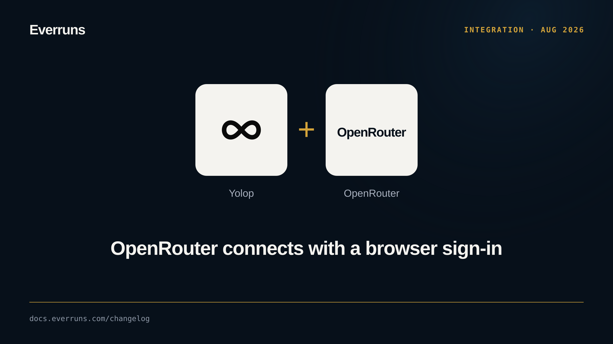

OpenRouter can now be connected from the browser. In `/setup`, pick OpenRouter
and then **Sign in with browser**: Yolop opens `openrouter.ai/auth`, waits on a
loopback callback, exchanges the code for an API key and stores it the same way
as a pasted key. ACP clients see the method as `openrouter_browser`.

A pasted key and `OPENROUTER_API_KEY` still work, and the environment variable
wins when both are set.

See [Providers and models](https://github.com/everruns/yolop#providers-and-models) and [#567](https://github.com/everruns/yolop/pull/567).
