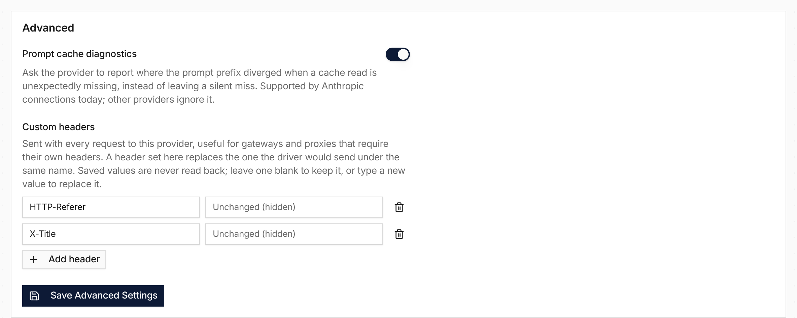

A provider connection now has request options that apply to every call through it, such as a header a gateway requires.

**In the UI:** open a provider in **Settings → Providers** and use the **Advanced** card to add **Custom headers** or turn on **Prompt cache diagnostics**.

**In the API:** the provider settings accept the same options. Transport headers such as `host` and `content-length` are rejected, the list is limited to 16 headers of up to 2 KB each, and header values are redacted in diagnostics. The Anthropic, Gemini, Chat Completions and Open Responses drivers apply them.

See [Providers](/providers/), [#3232](https://github.com/everruns/everruns/pull/3232) and [#3240](https://github.com/everruns/everruns/pull/3240).
