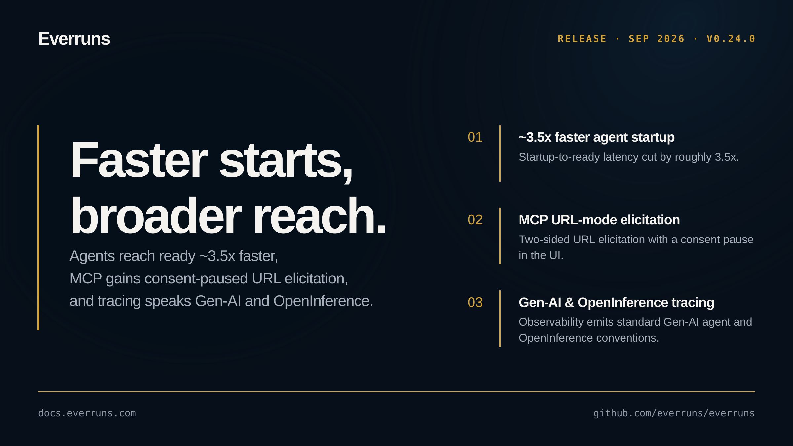

## Highlights

- **~3.5x faster agent startup**: Agent startup-to-ready latency cut by roughly 3.5x ([#3486](https://github.com/everruns/everruns/pull/3486)).
- **MCP URL-mode elicitation with a consent pause**: MCP elicitation now works in URL mode on both sides, with an explicit consent pause surfaced in the UI ([#3354](https://github.com/everruns/everruns/pull/3354)).
- **Gen-AI and OpenInference trace conventions**: Observability now emits Gen-AI agent and OpenInference trace conventions for standard agent tracing ([#3353](https://github.com/everruns/everruns/pull/3353)).
- **Expanded model catalog**: Added OpenAI GPT-6 Astra, Claude Fable 5.1, and Muse Spark 1.3 profiles with live-matrix coverage ([#3363](https://github.com/everruns/everruns/pull/3363), [#3351](https://github.com/everruns/everruns/pull/3351), [#3352](https://github.com/everruns/everruns/pull/3352)).
- **Broad provider wire-contract hardening**: A large sweep of driver and provider fixes plus expanded contract tests across Anthropic, OpenAI, Gemini, OpenRouter, Bedrock, MAI, Meta, and Fireworks, tightening streaming, usage, reasoning, and request-shaping behavior.

## In the changelog

- [First message of a new chat no longer drops or shows out of order](/changelog/2026-08-27-first-chat-message-fix/)
- [Everruns CLI plugins, skills and knowledge-bases commands work again](/changelog/2026-08-31-cli-plugins-skills-paths-fix/)
- [Organization default model can fall back to the platform default](/changelog/2026-08-31-org-default-model-platform-fallback/)
- [Only organization admins can rename an organization](/changelog/2026-08-31-org-updates-require-admin/)
- [Tool calls are validated against their schema before running](/changelog/2026-08-31-tool-argument-validation-strict/)
- [OpenTelemetry traces follow Gen-AI and OpenInference conventions](/changelog/2026-09-03-genai-openinference-trace-conventions/)
- [MCP URL elicitation pauses for consent in the Everruns UI](/changelog/2026-09-03-mcp-url-elicitation-consent/)
- [GPT-6 Astra, Claude Fable 5.1 and Muse Spark 1.3 model profiles](/changelog/2026-09-04-gpt-6-astra-fable-muse-spark/)
- [Framework agents start about 3.5 times faster](/changelog/2026-09-08-faster-framework-agent-startup/)

See the [GitHub release](https://github.com/everruns/everruns/releases/tag/v0.24.0) and the [full release notes](https://github.com/everruns/everruns/blob/main/CHANGELOG.md#0240---2026-09-09) for every pull request in this version.
