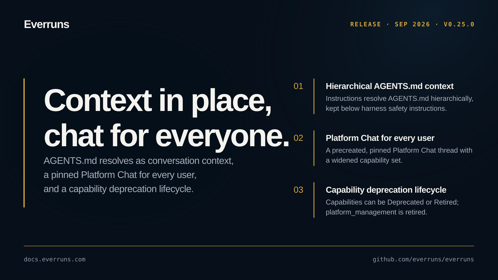

## Highlights

- **Hierarchical AGENTS.md as conversation context**: Agent instructions now resolve `AGENTS.md` files hierarchically and are injected as the leading user-role message of each turn, keeping untrusted workspace instructions below harness safety instructions in the instruction hierarchy ([#3501](https://github.com/everruns/everruns/pull/3501)).
- **Platform Chat for every user**: Each user gets a precreated, pinned Platform Chat thread, and the Platform Chat capability set is widened so it can drive more of the control plane ([#3508](https://github.com/everruns/everruns/pull/3508), [#3507](https://github.com/everruns/everruns/pull/3507)).
- **Capability deprecation lifecycle**: Capabilities can now be marked `Deprecated` (still functional, surfaces warn) or `Retired` (inert and hidden), and the `platform_management` capability was retired via the new lifecycle ([#3513](https://github.com/everruns/everruns/pull/3513)).
- **Unified `everruns` command tree for MCP and CLI**: A noun-verb command tree is now exposed over MCP, and a host can name the root token of its own command tree from the CLI ([#3490](https://github.com/everruns/everruns/pull/3490), [#3496](https://github.com/everruns/everruns/pull/3496)).
- **Safer provider onboarding and model management**: Provider API keys are validated before being stored, a configured key reliably produces a usable org, discovered models are adopted instead of conflicting on explicit create, and disabled models can be re-enabled ([#3516](https://github.com/everruns/everruns/pull/3516), [#3515](https://github.com/everruns/everruns/pull/3515), [#3517](https://github.com/everruns/everruns/pull/3517), [#3512](https://github.com/everruns/everruns/pull/3512)).

## In the changelog

- [AGENTS.md files resolve hierarchically as conversation context](/changelog/2026-09-10-agents-md-hierarchical-context/)
- [Every Everruns user starts in a pinned Platform Chat thread](/changelog/2026-09-11-platform-chat-thread-every-user/)
- [platform_management capability retired in favor of platform](/changelog/2026-09-11-retire-platform-management-capability/)

Before upgrading, read the breaking changes: [platform_management capability retired in favor of platform](/changelog/2026-09-11-retire-platform-management-capability/).

See the [GitHub release](https://github.com/everruns/everruns/releases/tag/v0.25.0) and the [full release notes](https://github.com/everruns/everruns/blob/main/CHANGELOG.md#0250---2026-09-11) for every pull request in this version.
