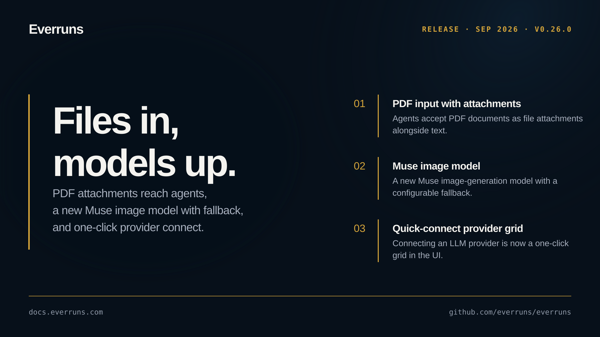

## Highlights

- **PDF input with file attachments**: Agents can now accept PDF documents as file attachments alongside text input ([#3535](https://github.com/everruns/everruns/pull/3535)).
- **Muse image model**: A new Muse image-generation model with a configurable fallback ([#3523](https://github.com/everruns/everruns/pull/3523)).
- **Quick-connect provider grid**: Connecting an LLM provider is now a one-click grid in the UI ([#3526](https://github.com/everruns/everruns/pull/3526)).
- **Native async tool execution on durable workers**: Long-running tool calls execute natively on durable workers instead of blocking a turn ([#3466](https://github.com/everruns/everruns/pull/3466)).
- **Synchronous wait-for-completion**: A non-streaming wait-for-completion path spanning drivers, the sessions API, and the framework ([#3541](https://github.com/everruns/everruns/pull/3541)).
- **Agent discovery documents**: The server serves agent discovery documents, and create_agent/session/message descriptions surface their argument constraints ([#3533](https://github.com/everruns/everruns/pull/3533), [#3530](https://github.com/everruns/everruns/pull/3530)).

## In the changelog

- [Everruns servers publish an MCP server card and auth.md](/changelog/2026-09-11-agent-discovery-documents/)
- [Connect an LLM provider with one pasted key, checked before saving](/changelog/2026-09-11-llm-provider-quick-connect/)
- [Image generation adds the Muse image model with a fallback](/changelog/2026-09-11-muse-image-model-fallback/)
- [Session schedules no longer fire twice on multi-replica deployments](/changelog/2026-09-11-session-schedules-no-double-fire/)
- [Attach PDF files to agent messages](/changelog/2026-09-12-pdf-file-attachments/)
- [Send a message and wait for the turn result in one request](/changelog/2026-09-12-wait-for-message-completion/)

See the [GitHub release](https://github.com/everruns/everruns/releases/tag/v0.26.0) and the [full release notes](https://github.com/everruns/everruns/blob/main/CHANGELOG.md#0260---2026-09-13) for every pull request in this version.
