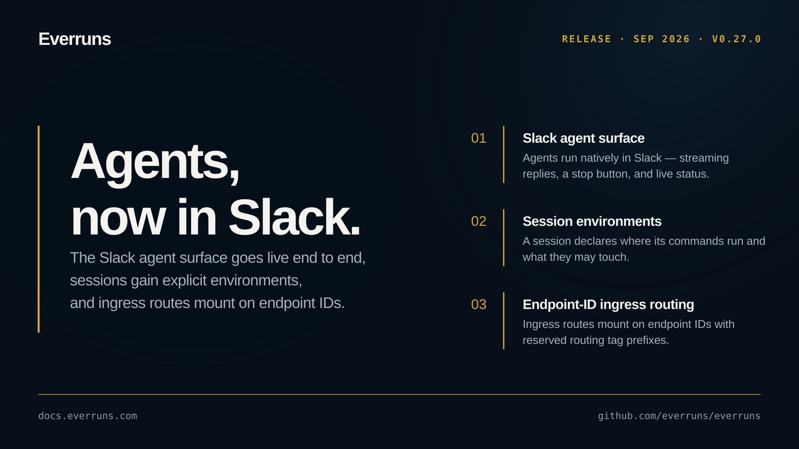

## Highlights

- **Slack agent surface**: Agents now run natively in Slack. The agent surface is enabled end to end: replies stream token-by-token into the pane, a stop button cancels the running turn, agent status and the thread title show while a turn runs, thread context is persisted and fed to the agent, and replies post as markdown blocks with correlation metadata ([#3560](https://github.com/everruns/everruns/pull/3560), [#3564](https://github.com/everruns/everruns/pull/3564), [#3568](https://github.com/everruns/everruns/pull/3568), [#3581](https://github.com/everruns/everruns/pull/3581), [#3567](https://github.com/everruns/everruns/pull/3567), [#3563](https://github.com/everruns/everruns/pull/3563)).
- **Session environments**: A session now declares where its commands run and what they may touch, giving agents an explicit execution environment ([#3599](https://github.com/everruns/everruns/pull/3599)).
- **Endpoint-ID ingress routing**: Ingress routes mount on endpoint IDs, with reserved routing tag prefixes to keep session routing unambiguous ([#3593](https://github.com/everruns/everruns/pull/3593), [#3589](https://github.com/everruns/everruns/pull/3589)).
- **Agent-owned exposure replaces Apps**: The App abstraction is retired from the product surface in favor of agent-owned exposure ([#3590](https://github.com/everruns/everruns/pull/3590), [#3585](https://github.com/everruns/everruns/pull/3585)).

## In the changelog

- [Sessions show where their commands run and what they may touch](/changelog/2026-09-14-session-environment-panel/)
- [Everruns agents run in Slack's agent pane](/changelog/2026-09-15-slack-agent-pane/)

See the [GitHub release](https://github.com/everruns/everruns/releases/tag/v0.27.0) and the [full release notes](https://github.com/everruns/everruns/blob/main/CHANGELOG.md#0270---2026-09-15) for every pull request in this version.
