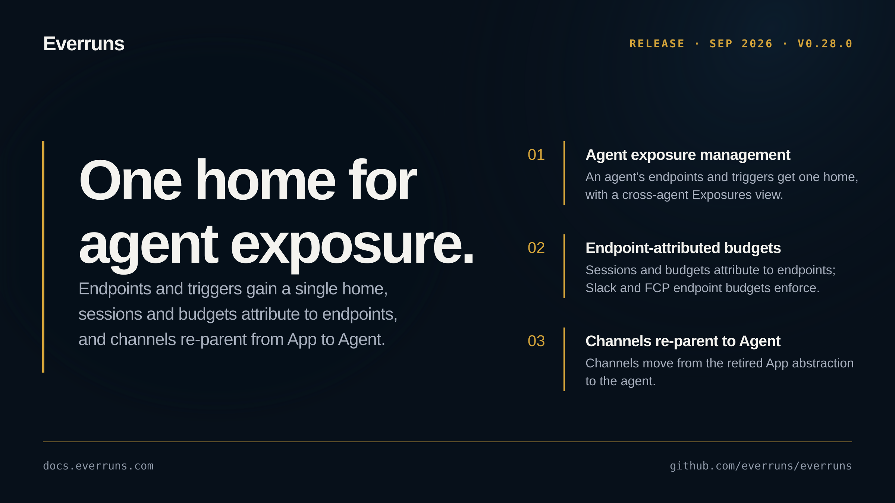

## Highlights

- **Agent exposure management**: An agent's endpoints and triggers now have one home, and a new cross-agent Exposures view lists exposure across all agents. Publish moves to the endpoint, and an agent's exposure can be suspended ([#3624](https://github.com/everruns/everruns/pull/3624), [#3627](https://github.com/everruns/everruns/pull/3627), [#3621](https://github.com/everruns/everruns/pull/3621)).
- **Endpoint-attributed sessions and budgets**: Sessions and budgets now attribute to the endpoint they arrive through, and Slack and FCP endpoint budgets bind and enforce their limits. Previously configured endpoint budgets that were inert will begin enforcing ([#3623](https://github.com/everruns/everruns/pull/3623), [#3625](https://github.com/everruns/everruns/pull/3625)).
- **Channels re-parent from App to Agent**: Channels move from the retired App abstraction to the agent, with grandfathered apps synthesized into agents automatically ([#3618](https://github.com/everruns/everruns/pull/3618), [#3598](https://github.com/everruns/everruns/pull/3598)).

## In the changelog

- [The Everruns UI supports dark mode with a theme setting](/changelog/2026-09-16-ui-dark-mode-theme/)

See the [GitHub release](https://github.com/everruns/everruns/releases/tag/v0.28.0) and the [full release notes](https://github.com/everruns/everruns/blob/main/CHANGELOG.md#0280---2026-09-16) for every pull request in this version.
