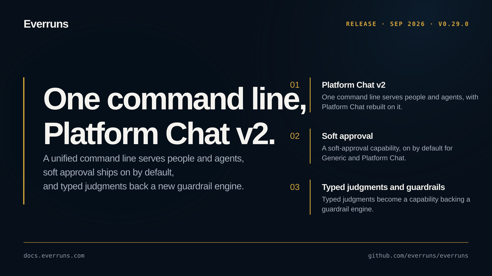

## Highlights

- **Platform Chat v2 on a unified command line**: One command line serves both people and agents, with Platform Chat rebuilt on top of it ([#3680](https://github.com/everruns/everruns/pull/3680)).
- **Soft approval**: A soft-approval capability lands and is on by default for Generic and Platform Chat, so an agent can proceed with a lightweight, reversible approval step ([#3655](https://github.com/everruns/everruns/pull/3655)).
- **Typed judgments and a guardrail engine**: Typed judgments become a capability, backing a guardrail engine for classifying and gating agent behavior ([#3644](https://github.com/everruns/everruns/pull/3644)).
- **Scoped MCP catalogs and acts-as**: MCP gains scoped catalog presets and acts-as credential semantics, with endpoint auth stored separately ([#3638](https://github.com/everruns/everruns/pull/3638), [#3635](https://github.com/everruns/everruns/pull/3635)).

## In the changelog

- [Framework direct model calls with Model::complete](/changelog/2026-09-16-framework-direct-model-calls/)
- [One everruns command line for the CLI, MCP and agent shells](/changelog/2026-09-17-everruns-command-line-tree/)
- [Guardrails can use typed judgments as their check engine](/changelog/2026-09-17-guardrails-typed-judgment-engine/)
- [Soft approval: agents pause before destructive or outward actions](/changelog/2026-09-17-soft-approval-capability/)

See the [GitHub release](https://github.com/everruns/everruns/releases/tag/v0.29.0) and the [full release notes](https://github.com/everruns/everruns/blob/main/CHANGELOG.md#0290---2026-09-18) for every pull request in this version.
