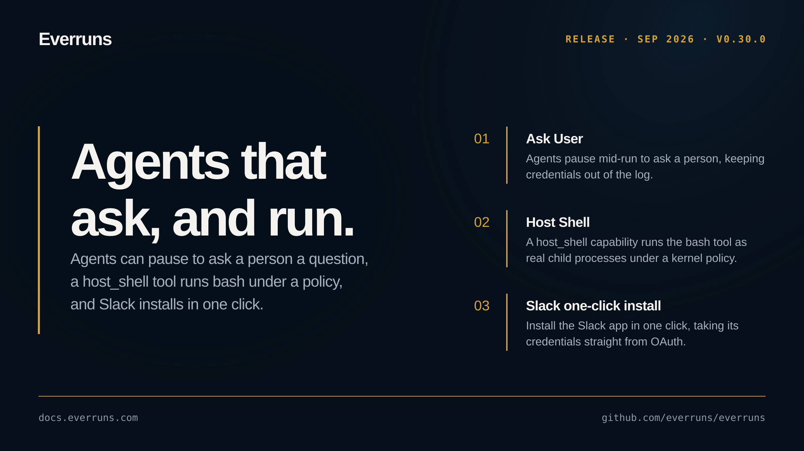

## Highlights

- **Ask User**: Agents can pause mid-run to ask a person a question: an inline UI card in Platform Chat ([#3735](https://github.com/everruns/everruns/pull/3735)), in-process and hosted strategies ([#3738](https://github.com/everruns/everruns/pull/3738)), expiry that resolves to declared defaults ([#3757](https://github.com/everruns/everruns/pull/3757)), and credential collection that never enters the log or agent context ([#3747](https://github.com/everruns/everruns/pull/3747)). Enabled on the default chat harnesses ([#3737](https://github.com/everruns/everruns/pull/3737)).
- **Host Shell**: A new `host_shell` capability runs the `bash` tool as real child processes on the machine hosting the agent, bounded by a kernel policy (Seatbelt and Landlock). Behind the `host-shell` feature on `everruns` or `everruns-host`; see the [host shell example](https://github.com/everruns/everruns/tree/main/examples/host-shell-agent) ([#3719](https://github.com/everruns/everruns/pull/3719)).
- **Slack one-click install**: Install the Slack app in one click, creating the app and taking its credentials straight from OAuth ([#3724](https://github.com/everruns/everruns/pull/3724)).
- **New models**: Claude Opus 5.5 lands as the recommended Opus ([#3769](https://github.com/everruns/everruns/pull/3769)), and GPT-6 Sol and Luna arrive with GPT-6 Luna as the default chat and utility model ([#3771](https://github.com/everruns/everruns/pull/3771), [#3774](https://github.com/everruns/everruns/pull/3774)).
- **Agent endpoint budget controls**: Set spend budgets on agent endpoints from the UI ([#3719](https://github.com/everruns/everruns/pull/3719)).

## In the changelog

- [Agent endpoints and triggers replace Apps in Everruns](/changelog/2026-09-18-agent-endpoints-replace-apps/)
- [Slack agents ask approval with buttons and show task progress](/changelog/2026-09-18-slack-approvals-progress-actions/)
- [Set spend budgets on agent endpoints from the Integrations tab](/changelog/2026-09-19-agent-endpoint-budgets/)
- [Host Shell gives Framework agents a kernel-contained Bash](/changelog/2026-09-19-framework-host-shell/)
- [MCP catalog presets, acts-as identity and personal connections](/changelog/2026-09-19-mcp-catalog-connections-acts-as/)
- [Install an Everruns agent in Slack with one click](/changelog/2026-09-19-slack-one-click-install/)
- [Claude Opus 5.5, GPT-6 Sol and GPT-6 Luna models added](/changelog/2026-09-22-claude-opus-5-5-gpt-6-models/)

Before upgrading, read the breaking changes: [Agent endpoints and triggers replace Apps in Everruns](/changelog/2026-09-18-agent-endpoints-replace-apps/).

See the [GitHub release](https://github.com/everruns/everruns/releases/tag/v0.30.0) and the [full release notes](https://github.com/everruns/everruns/blob/main/CHANGELOG.md#0300---2026-09-23) for every pull request in this version.
