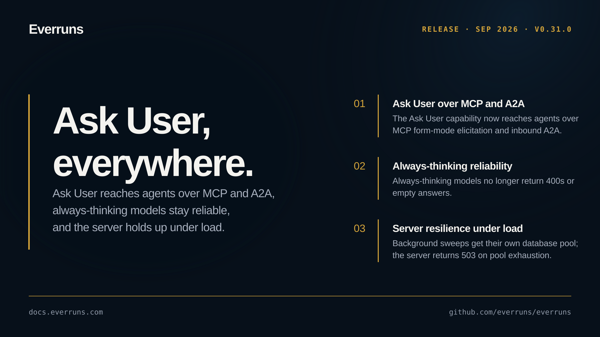

## Highlights

- **Ask User over MCP and A2A**: The Ask User capability now reaches agents beyond Platform Chat: it projects as form-mode elicitation over `/mcp` ([#3781](https://github.com/everruns/everruns/pull/3781)) and is carried over the inbound A2A channel as a DataPart ([#3780](https://github.com/everruns/everruns/pull/3780)).
- **Always-thinking model reliability**: Always-thinking models no longer return 400s or empty answers ([#3782](https://github.com/everruns/everruns/pull/3782)), preserved thinking keeps the conversation append-only ([#3783](https://github.com/everruns/everruns/pull/3783)), append-only `clear_at` reminders land ([#3787](https://github.com/everruns/everruns/pull/3787)), and hosted tool-search replay order is preserved ([#3789](https://github.com/everruns/everruns/pull/3789)).
- **Server resilience under load**: Background sweeps run isolated with their own database pool ([#3786](https://github.com/everruns/everruns/pull/3786), [#3779](https://github.com/everruns/everruns/pull/3779)), and the server returns a graceful 503 on database pool exhaustion instead of failing hard ([#3788](https://github.com/everruns/everruns/pull/3788)).

## In the changelog

- [Claude always-thinking models no longer return 400s or empty answers](/changelog/2026-09-23-claude-always-thinking-fixes/)
- [Ask User lets agents pause and ask you questions mid-run](/changelog/2026-09-24-ask-user-agent-questions/)

See the [GitHub release](https://github.com/everruns/everruns/releases/tag/v0.31.0) and the [full release notes](https://github.com/everruns/everruns/blob/main/CHANGELOG.md#0310---2026-09-24) for every pull request in this version.
