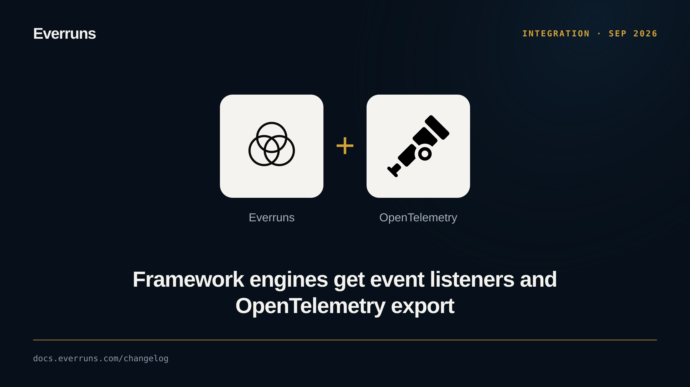

An Engine now delivers every event from every session it owns, including
resumed and spawned ones, to the listeners registered on it. You no longer poll
`Session::events()` per session. Each listener drains a bounded ordered queue,
and shutdown flushes them within one deadline.

The `everruns` crate ships two listeners behind independent features, `otel`
and `braintrust`:

```rust
let engine = Engine::builder()
    .observe(OpenTelemetry::from_env())
    .build();
```

Message content is not exported by default.

See [Observability](/framework/observability/). PRs [#3804](https://github.com/everruns/everruns/pull/3804),
[#3806](https://github.com/everruns/everruns/pull/3806).
