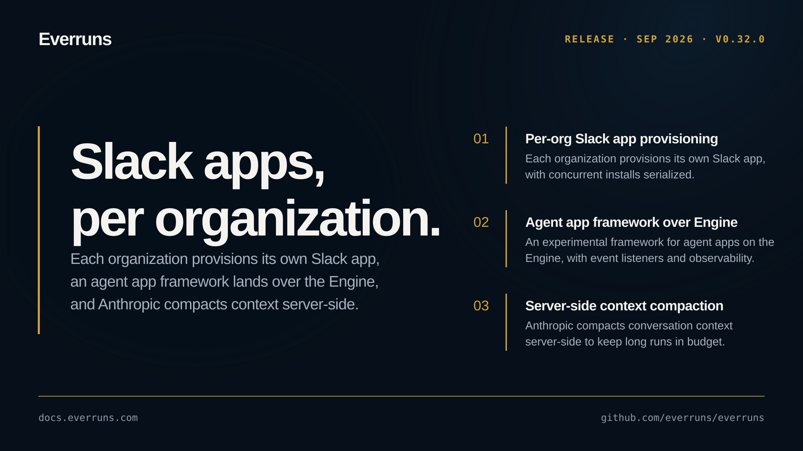

## Highlights

- **Per-organization Slack app provisioning**: Each organization can provision its own Slack app rather than sharing one deployment-wide install ([#3830](https://github.com/everruns/everruns/pull/3830)), with concurrent installs for one endpoint serialized so a race can no longer create orphan apps or exhaust the config token ([#3843](https://github.com/everruns/everruns/pull/3843)).
- **Agent app framework over Engine**: An experimental framework for building agent apps directly on the Engine ([#3802](https://github.com/everruns/everruns/pull/3802)), with engine-level event listeners ([#3804](https://github.com/everruns/everruns/pull/3804)) and pluggable observability integrations ([#3806](https://github.com/everruns/everruns/pull/3806)).
- **Server-side context compaction**: Anthropic conversations compact context server-side, keeping long agent runs within budget ([#3831](https://github.com/everruns/everruns/pull/3831)).
- **Ask User through tasks**: The Ask User capability surfaces through the tasks channel, extending it beyond Platform Chat and MCP ([#3828](https://github.com/everruns/everruns/pull/3828)).
- **Server hardening**: Platform Chat question-answers and tool-results now require the session owner ([#3842](https://github.com/everruns/everruns/pull/3842)), unrequested reasoning summaries stay hidden from responses ([#3840](https://github.com/everruns/everruns/pull/3840)), feature-flag revocations take effect immediately ([#3820](https://github.com/everruns/everruns/pull/3820)), retained observer event memory is bounded ([#3837](https://github.com/everruns/everruns/pull/3837)), and native endpoint sessions are reused rather than rebuilt ([#3814](https://github.com/everruns/everruns/pull/3814)).

## In the changelog

- [Ask User questions reach MCP, A2A and Tasks clients](/changelog/2026-09-25-ask-user-mcp-a2a-clients/)
- [Framework engines get event listeners and OpenTelemetry export](/changelog/2026-09-25-framework-event-listeners-opentelemetry/)

See the [GitHub release](https://github.com/everruns/everruns/releases/tag/v0.32.0) and the [full release notes](https://github.com/everruns/everruns/blob/main/CHANGELOG.md#0320---2026-09-26) for every pull request in this version.
