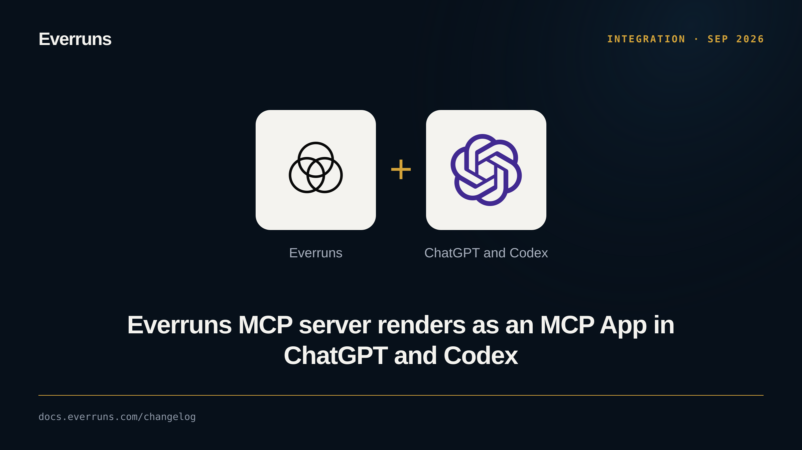

The Everruns MCP server at `/mcp` is now an MCP App. Supported hosts show a
session view with status, messages and a reply box. Questions appear as a form,
and approvals refuse stale clicks. An Everruns panel opens from the ChatGPT
sidebar. Hosts without app rendering retain text tools.

See [MCP: In ChatGPT and Codex](/features/mcp/#in-chatgpt-and-codex).

## Update 2026-11-02

Agent cards use MCP Apps templates instead of exposing raw HTML, with a text
summary for clients without app rendering.

## Update 2026-11-03

Agent, Harness, Capability and Knowledge cards now reuse the product UI. Home
and Session open the full workspaces, including Session Trace. See
[the shared workspace update](/changelog/2026-11-03-mcp-shared-workspaces/).
