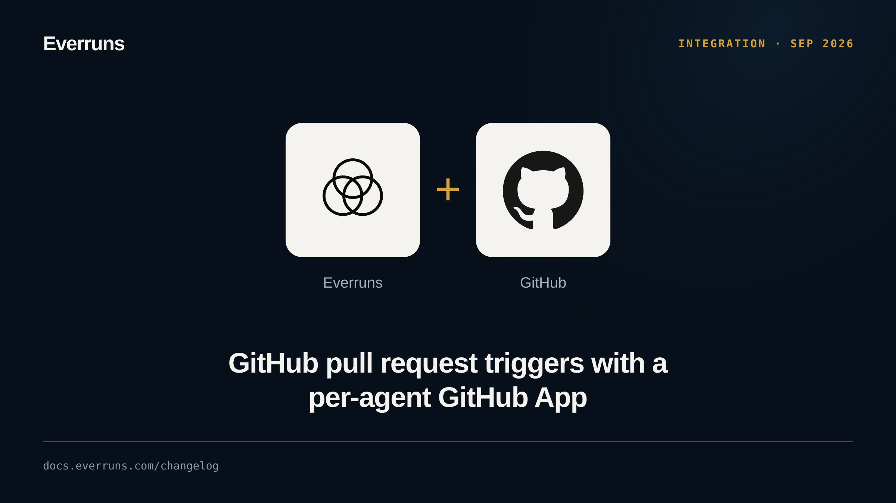

An agent can now act on GitHub pull requests. Use the **Connect GitHub** card on
the agent's Integrations tab to create and install the agent's own GitHub App.
The [GitHub](/capabilities/github/) capability then gives it
`get_github_pull_request`, `get_github_pull_request_diff` and
`upsert_github_comment`.

Add a trigger in GitHub mode, or from the CLI with `--github-events` and
`--repositories`, to start work on pull request events. Webhooks are signature
verified, deduplicated by delivery ID, and routed to one session per pull
request. Every trigger now shares that pipeline, so webhook triggers also accept
filters and dedupe templates.

See [Summarize GitHub pull requests](/how-to/summarize-github-pull-requests/).
PRs [#3935](https://github.com/everruns/everruns/pull/3935), [#3943](https://github.com/everruns/everruns/pull/3943), [#3915](https://github.com/everruns/everruns/pull/3915).
