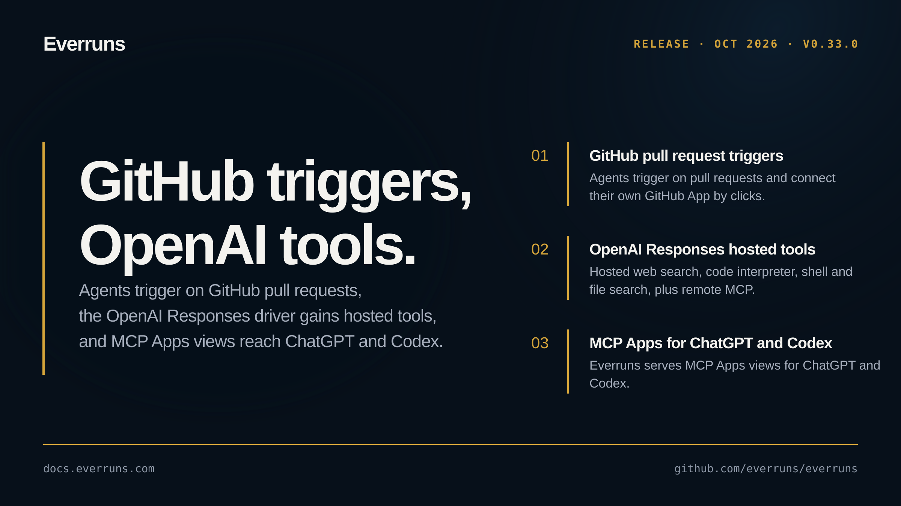

## Highlights

- **GitHub pull request triggers and per-agent GitHub Apps**: Agents connect their own GitHub App by clicks and act on pull requests, with PR triggers, a Connect GitHub card, PR tools, and a PR summarizer guide ([#3935](https://github.com/everruns/everruns/pull/3935), [#3943](https://github.com/everruns/everruns/pull/3943)).
- **OpenAI Responses hosted tools and remote MCP**: The OpenAI Responses driver gains hosted web search ([#3918](https://github.com/everruns/everruns/pull/3918), [#3923](https://github.com/everruns/everruns/pull/3923)), hosted code interpreter, shell and file search ([#3928](https://github.com/everruns/everruns/pull/3928)), remote MCP with approval and registered-server credentials ([#3930](https://github.com/everruns/everruns/pull/3930)), and structured output with background mode ([#3932](https://github.com/everruns/everruns/pull/3932)).
- **Agent trigger event pipeline**: A new event pipeline with filters, dedupe, and per-subject sessions ([#3915](https://github.com/everruns/everruns/pull/3915)), plus outbound MCP Events for session webhooks ([#3931](https://github.com/everruns/everruns/pull/3931)).
- **MCP Apps for ChatGPT and Codex**: Everruns serves MCP Apps views for ChatGPT and Codex ([#3927](https://github.com/everruns/everruns/pull/3927)), answering form-mode elicitation through ask_user ([#3929](https://github.com/everruns/everruns/pull/3929)).
- **Pluggable decision drivers**: Decision drivers route behind one router ([#3921](https://github.com/everruns/everruns/pull/3921)), with the OpenAI Decisions API available as a preview driver ([#3924](https://github.com/everruns/everruns/pull/3924)).
- **Provider-neutral computer use**: A provider-neutral computer tool runs on Browserless ([#3922](https://github.com/everruns/everruns/pull/3922)).
- **New models**: Claude Sonnet 5.5 joins as the favorite Sonnet ([#3902](https://github.com/everruns/everruns/pull/3902)) and GPT-6.1 Sol arrives with fast and ultrafast speed tiers ([#3925](https://github.com/everruns/everruns/pull/3925)); the sunset Claude Sonnet 4.5 profile is dropped ([#3952](https://github.com/everruns/everruns/pull/3952)).
- **Rebuilt agent workspace**: The agent page is rebuilt as a single view-and-edit workspace ([#3917](https://github.com/everruns/everruns/pull/3917)).

## In the changelog

- [Agent page rebuilt as one view-and-edit workspace](/changelog/2026-09-29-agent-page-workspace/)
- [Everruns MCP server renders as an MCP App in ChatGPT and Codex](/changelog/2026-09-29-mcp-app-chatgpt-codex/)
- [Claude Sonnet 5.5 and GPT-6.1 Sol with fast and ultrafast tiers](/changelog/2026-09-30-claude-sonnet-5-5-gpt-6-1-sol/)
- [GitHub pull request triggers with a per-agent GitHub App](/changelog/2026-09-30-github-pull-request-triggers/)
- [OpenAI hosted code interpreter, shell, file search and remote MCP](/changelog/2026-09-30-openai-hosted-tools-remote-mcp/)

See the [GitHub release](https://github.com/everruns/everruns/releases/tag/v0.33.0) and the [full release notes](https://github.com/everruns/everruns/blob/main/CHANGELOG.md#0330---2026-10-01) for every pull request in this version.
