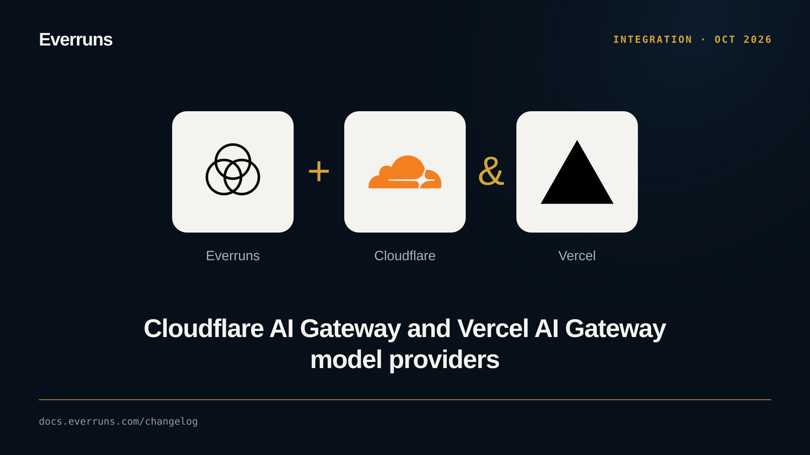

Two gateway providers are available. **Cloudflare** reaches many upstream
providers and Cloudflare's own Workers AI models through one account token and
account ID. **Vercel AI Gateway** uses its OpenAI-compatible Responses endpoint
and syncs its model list.

The Cloudflare provider lists Workers AI text-generation models with their
context window and tool support. Third-party model IDs on Cloudflare are still
added by hand, because no endpoint lists what an account can bill.

This also fixes a token dropped from Cloudflare streams when the model emitted
a purely numeric token.

See [Cloudflare](/providers/cloudflare/) and [Vercel](/providers/vercel/). PRs
[#3996](https://github.com/everruns/everruns/pull/3996), [#4021](https://github.com/everruns/everruns/pull/4021).
