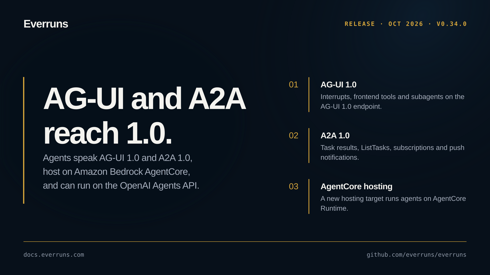

## Highlights

- **AG-UI 1.0**: A new `everruns-ag-ui` crate carries the AG-UI 1.0 wire types ([#3964](https://github.com/everruns/everruns/pull/3964)), and the AG-UI endpoint moves to protocol 1.0 with interrupts, resume, token usage, frontend tools, subagents and run metadata ([#3965](https://github.com/everruns/everruns/pull/3965), [#3967](https://github.com/everruns/everruns/pull/3967), [#3972](https://github.com/everruns/everruns/pull/3972), [#3979](https://github.com/everruns/everruns/pull/3979)). Any framework session serves AG-UI behind the `ag-ui` feature, with a durable thread store and a ready-made axum handler ([#3976](https://github.com/everruns/everruns/pull/3976), [#3998](https://github.com/everruns/everruns/pull/3998), [#4000](https://github.com/everruns/everruns/pull/4000)), `everruns-serve` exposes an AG-UI channel ([#3978](https://github.com/everruns/everruns/pull/3978)), and a consumer pipeline and SSE client ship with an upstream conformance corpus ([#3982](https://github.com/everruns/everruns/pull/3982)).
- **A2A 1.0**: The A2A endpoint speaks A2A 1.0 and returns task results ([#3999](https://github.com/everruns/everruns/pull/3999)), with ListTasks, SubscribeToTask ([#4010](https://github.com/everruns/everruns/pull/4010)) and push notifications ([#4013](https://github.com/everruns/everruns/pull/4013)); `everruns-serve` serves every agent over A2A behind an `a2a` feature ([#4014](https://github.com/everruns/everruns/pull/4014)).
- **Amazon Bedrock AgentCore hosting**: The new `everruns-serve-agentcore` crate hosts agents on AgentCore Runtime, with Bedrock through the execution role, WebSocket transport and durable approvals ([#3990](https://github.com/everruns/everruns/pull/3990), [#4012](https://github.com/everruns/everruns/pull/4012)).
- **OpenAI Agents API backend**: An opt-in durable OpenAI Agents API backend ([#3957](https://github.com/everruns/everruns/pull/3957)) projects events, usage and cost ([#3961](https://github.com/everruns/everruns/pull/3961)), supports session lifecycle and portability ([#3963](https://github.com/everruns/everruns/pull/3963)), and enforces Everruns policy at tool boundaries ([#3959](https://github.com/everruns/everruns/pull/3959)).
- **Native computer use with hard approval**: Native OpenAI and Anthropic computer tools run behind a hard tool-approval gate ([#3968](https://github.com/everruns/everruns/pull/3968), [#3956](https://github.com/everruns/everruns/pull/3956)).
- **Slack workspaces per organization**: Organizations connect Slack workspaces and pick one per agent ([#3977](https://github.com/everruns/everruns/pull/3977)).
- **Agent version pinning**: Endpoints and triggers can pin a specific agent version ([#3975](https://github.com/everruns/everruns/pull/3975)).
- **More ways to reach models**: Cloudflare and Vercel AI Gateway drivers ([#3996](https://github.com/everruns/everruns/pull/3996)), an opt-in Responses WebSocket transport for OpenAI ([#3981](https://github.com/everruns/everruns/pull/3981)), and OpenAI background responses that re-attach after a worker restart ([#3969](https://github.com/everruns/everruns/pull/3969)).
- **GitHub and MCP triggers**: PR reviewer and security scanner templates on the GitHub App ([#3980](https://github.com/everruns/everruns/pull/3980)), and agents that wake on inbound MCP events ([#3970](https://github.com/everruns/everruns/pull/3970)).
- **`everruns-durable` on crates.io**: The durable workflow engine fires timers, runs child workflows and ships with a bundled PostgreSQL schema ([#3994](https://github.com/everruns/everruns/pull/3994), [#4008](https://github.com/everruns/everruns/pull/4008)).

## In the changelog

- [PR reviewer and security scanner agent templates for GitHub](/changelog/2026-10-01-github-review-security-templates/)
- [MCP Events add session webhooks and triggers on MCP server events](/changelog/2026-10-01-mcp-events-webhooks-triggers/)
- [OpenAI structured output and background mode for long reasoning](/changelog/2026-10-01-openai-structured-output-background/)
- [Connect several Slack workspaces per organization](/changelog/2026-10-01-slack-workspaces-per-organization/)
- [A2A 1.0 endpoint with task results, streaming and push notifications](/changelog/2026-10-02-a2a-1-0-protocol/)
- [AG-UI 1.0 endpoint and AG-UI streaming for Framework sessions](/changelog/2026-10-02-ag-ui-1-0-protocol/)

See the [GitHub release](https://github.com/everruns/everruns/releases/tag/v0.34.0) and the [full release notes](https://github.com/everruns/everruns/blob/main/CHANGELOG.md#0340---2026-10-02) for every pull request in this version.
