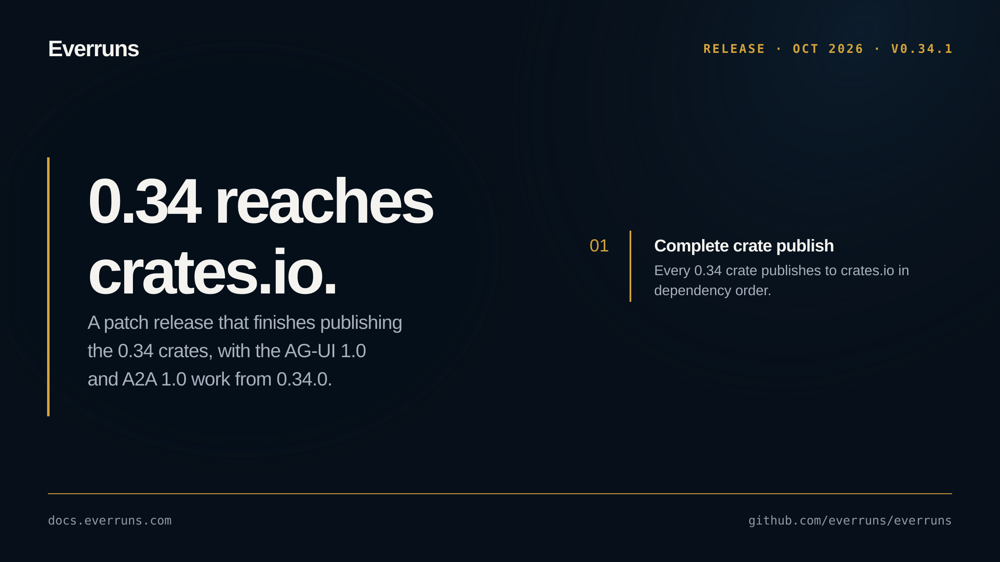

## In the changelog

- [everruns-durable workflow engine published on crates.io](/changelog/2026-10-02-everruns-durable-crate-published/)
- [Host Everruns serve apps on Amazon Bedrock AgentCore Runtime](/changelog/2026-10-02-serve-on-bedrock-agentcore/)

See the [GitHub release](https://github.com/everruns/everruns/releases/tag/v0.34.1) and the [full release notes](https://github.com/everruns/everruns/blob/main/CHANGELOG.md#0341---2026-10-02) for every pull request in this version.
