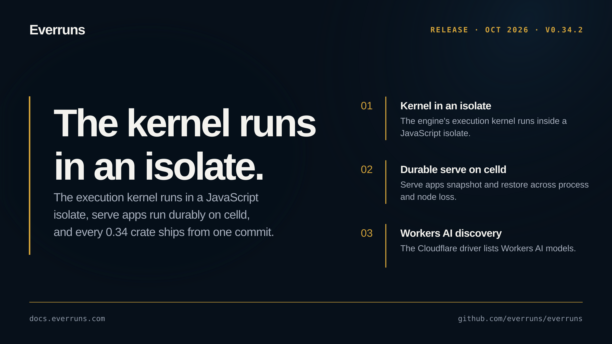

## Highlights

- **Execution kernel in a JavaScript isolate**: the engine's execution kernel runs inside a JavaScript isolate, with a celld engine cell ([#4024](https://github.com/everruns/everruns/pull/4024))
- **Durable serve apps on celld**: new `everruns-serve-celld` hosting target snapshots and restores a serve app across process and node loss ([#4019](https://github.com/everruns/everruns/pull/4019))
- **Workers AI model discovery**: the Cloudflare driver lists Workers AI models, and Chat Completions streams keep tokens sent as JSON numbers ([#4021](https://github.com/everruns/everruns/pull/4021))

## In the changelog

- [Cloudflare AI Gateway and Vercel AI Gateway model providers](/changelog/2026-10-02-cloudflare-vercel-ai-gateway/)
- [Run an Everruns serve app durably on celld](/changelog/2026-10-02-serve-celld-durable-hosting/)

See the [GitHub release](https://github.com/everruns/everruns/releases/tag/v0.34.2) and the [full release notes](https://github.com/everruns/everruns/blob/main/CHANGELOG.md#0342---2026-10-02) for every pull request in this version.
