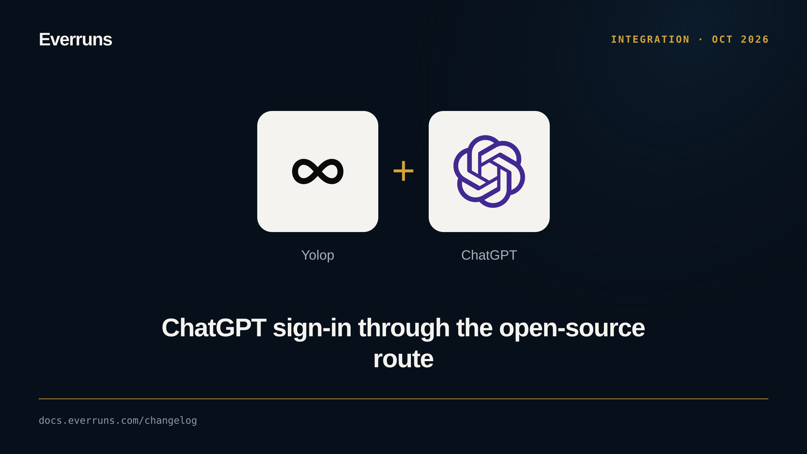

A browser sign-in for `--provider codex` now uses OpenAI's open-source Sign in
with ChatGPT by default. Yolop registers its own client for your account on the
first sign-in and runs turns on the public Responses API, still billed to your
ChatGPT plan. It is a preview route, so a few request options (output token
cap, temperature, `speed`) do not apply.

To keep the Codex login, set the route and sign in again:

```bash
yolop config set chatgpt_sign_in codex
```

`YOLOP_CHATGPT_SIGN_IN=codex` does the same. A device login uses the Codex
route unless `open-source` is set.

See [Providers and models](https://github.com/everruns/yolop#providers-and-models), [#806](https://github.com/everruns/yolop/pull/806) and [#808](https://github.com/everruns/yolop/pull/808).
