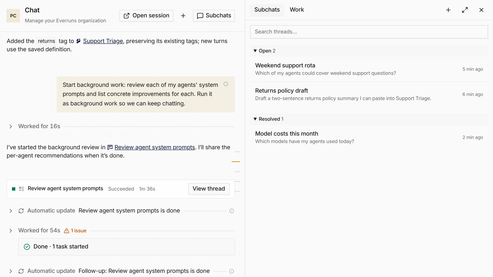

Organization owners and admins can turn on **Chat threads** in
**Settings > Features**. With it on, the sidebar holds only Chat, and a
**Threads** panel beside the permanent conversation lists your other
conversations and the work running in the background.

Create a **New thread**, search conversations, and open work from its card,
where you can answer pending input or stop it. **Resolve thread** puts a
conversation away without losing history, and **Reopen thread** continues it.
The panel becomes a drawer on mobile. Turning the feature off restores the
previous Chat and keeps conversations and their URLs.

See [Chat and Threads](/features/ui/#chat-and-threads). PR [#4146](https://github.com/everruns/everruns/pull/4146).
