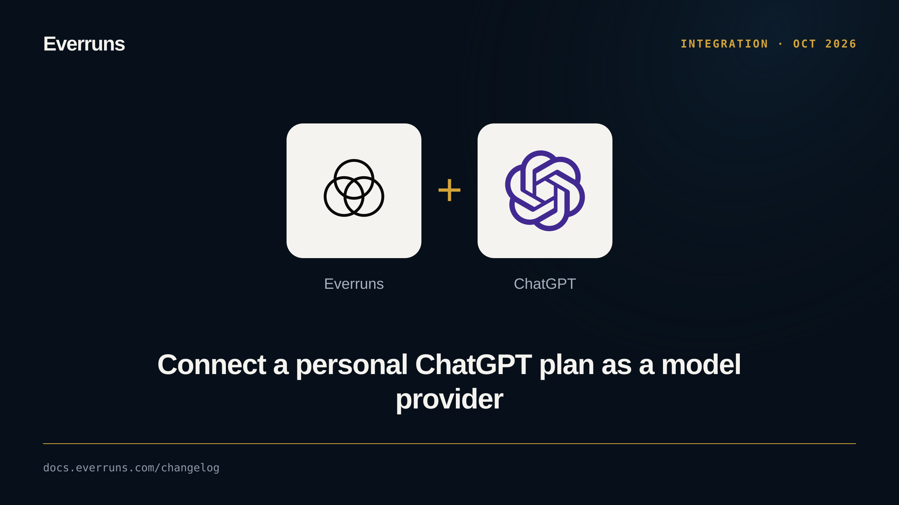

ChatGPT now appears in the provider grid. Open **Models > Providers > Connect
provider > ChatGPT > Sign in with ChatGPT**, approve plan use in ChatGPT, and
return to Everruns. The connection belongs to you, not the organization: its
models are available only to you, and the detail page shows account status,
quota guidance, and reconnect and disconnect controls.

Self-hosted deployments use OpenAI's Sign in with ChatGPT for open-source
applications. The ChatGPT plan transport is now part of `everruns-drivers`.

See [ChatGPT plan](/features/chatgpt/). PR [#4136](https://github.com/everruns/everruns/pull/4136).
