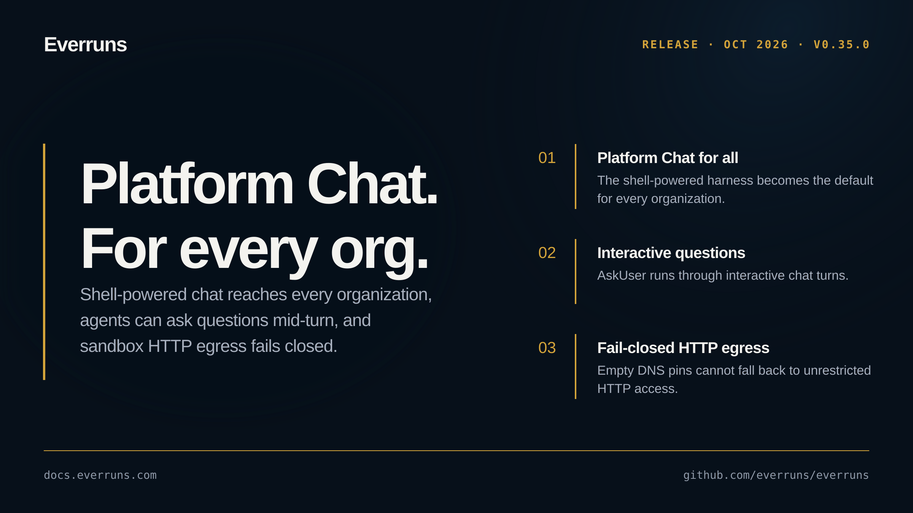

## Highlights

- **Safer sandbox tools**: HTTP egress fails closed on empty DNS pins, and forged session secrets cannot redirect Docker tools ([#4058](https://github.com/everruns/everruns/pull/4058), [#4061](https://github.com/everruns/everruns/pull/4061)).
- **Interactive questions in chat**: AskUser runs through interactive turns so agents can ask for input while working ([#4044](https://github.com/everruns/everruns/pull/4044)).
- **Platform Chat for every organization**: the shell-powered Platform Chat harness becomes the default for every organization ([#4060](https://github.com/everruns/everruns/pull/4060)).

## In the changelog

- [Computer use capability lets agents operate a browser screen](/changelog/2026-10-03-computer-use-capability/)

See the [GitHub release](https://github.com/everruns/everruns/releases/tag/v0.35.0) and the [full release notes](https://github.com/everruns/everruns/blob/main/CHANGELOG.md#0350---2026-10-03) for every pull request in this version.
