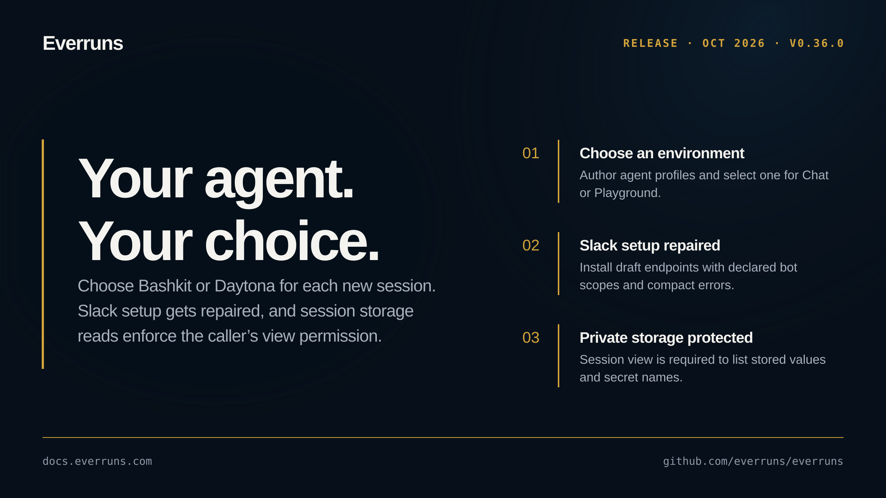

## Highlights

- **Choose an Agent Environment**: Author named Bashkit or Daytona profiles and select the profile when starting a Chat or Playground session.
- **Slack installation repair**: Add to Slack works for draft endpoints, requests declared bot scopes, and shows compact errors with retry.
- **Session storage permissions**: Listing stored values or secret names requires session view; denied callers receive no private data.

See the [GitHub release](https://github.com/everruns/everruns/releases/tag/v0.36.0) and the [full release notes](https://github.com/everruns/everruns/blob/main/CHANGELOG.md#0360---2026-10-03) for every pull request in this version.
