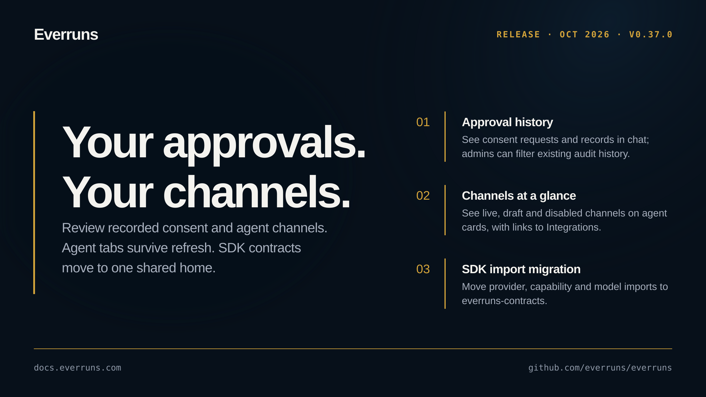

## Highlights

- **Approval history in context**: Chats show approval requests and recorded consent; organization admins and owners can filter existing spoken-consent audit history ([#4110](https://github.com/everruns/everruns/pull/4110)).
- **Agent channels at a glance**: Compact agent cards show transport and live, draft or disabled status, with links to Integrations ([#4109](https://github.com/everruns/everruns/pull/4109)).
- **Navigation keeps your place**: Sidebar selection updates as navigation starts, and agent tabs survive refresh through their URL ([#4108](https://github.com/everruns/everruns/pull/4108), [#4111](https://github.com/everruns/everruns/pull/4111)).
- **Slack installation returns to setup**: Valid OAuth callbacks return to the owning agent's endpoint editor; invalid callbacks use the agents page ([#4107](https://github.com/everruns/everruns/pull/4107)).

## In the changelog

- [Approval history in chat and a new Approvals audit page](/changelog/2026-10-03-approval-history-audit-page/)

See the [GitHub release](https://github.com/everruns/everruns/releases/tag/v0.37.0) and the [full release notes](https://github.com/everruns/everruns/blob/main/CHANGELOG.md#0370---2026-10-03) for every pull request in this version.
