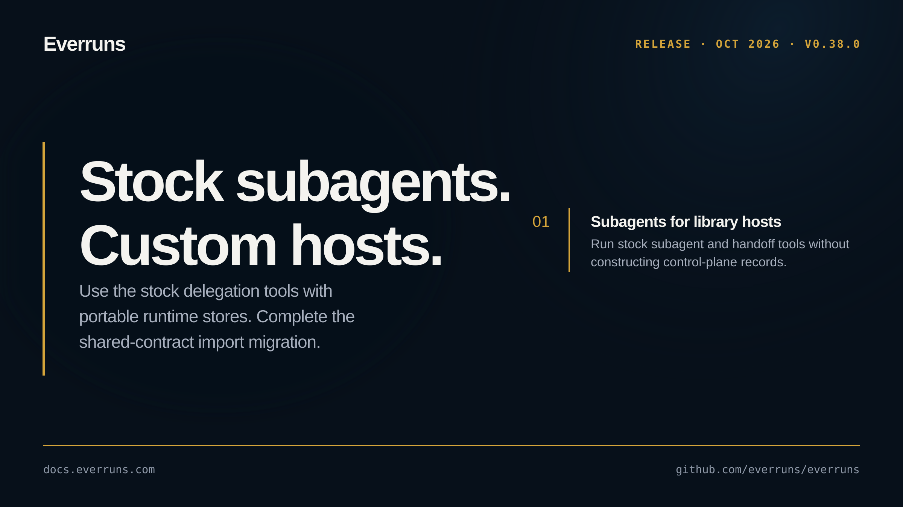

## Highlights

- **Personal ChatGPT plan connections**: Self-hosted deployments can enable personal account sign-in and discover its available models; connections stay scoped to the signed-in user ([#4136](https://github.com/everruns/everruns/pull/4136)).
- **Stock subagents for custom hosts**: Library hosts can run the stock subagent and handoff tools through a store of portable runtime definitions, without constructing control-plane records ([#4078](https://github.com/everruns/everruns/pull/4078)).

## In the changelog

- [Connect a personal ChatGPT plan as a model provider](/changelog/2026-10-03-chatgpt-plan-provider/)
- [Conversation becomes the default harness and Generic is deprecated](/changelog/2026-10-03-conversation-default-harness/)
- [Feature flag grade preview renamed to internal for operators](/changelog/2026-10-03-feature-grades-preview-internal/)
- [Playground for testing agents, and Chat as one permanent conversation](/changelog/2026-10-03-playground-agent-testing/)

Before upgrading, read the breaking changes: [Conversation becomes the default harness and Generic is deprecated](/changelog/2026-10-03-conversation-default-harness/), [Feature flag grade preview renamed to internal for operators](/changelog/2026-10-03-feature-grades-preview-internal/).

See the [GitHub release](https://github.com/everruns/everruns/releases/tag/v0.38.0) and the [full release notes](https://github.com/everruns/everruns/blob/main/CHANGELOG.md#0380---2026-10-03) for every pull request in this version.
