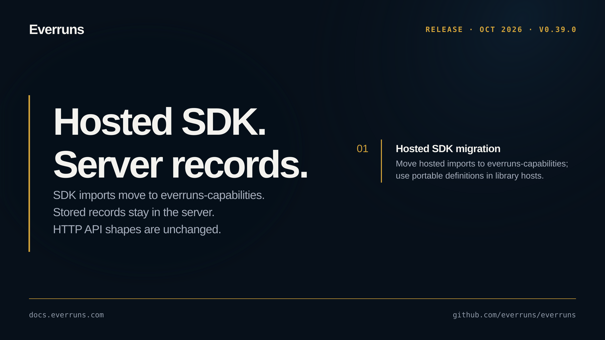

## In the changelog

- [Chat threads keep conversations and ongoing work beside Chat](/changelog/2026-10-03-chat-threads-workspace/)
- [Slack permission issues appear in Health with recovery steps](/changelog/2026-10-03-slack-health-issues-recovery/)

See the [GitHub release](https://github.com/everruns/everruns/releases/tag/v0.39.0) and the [full release notes](https://github.com/everruns/everruns/blob/main/CHANGELOG.md#0390---2026-10-04) for every pull request in this version.
