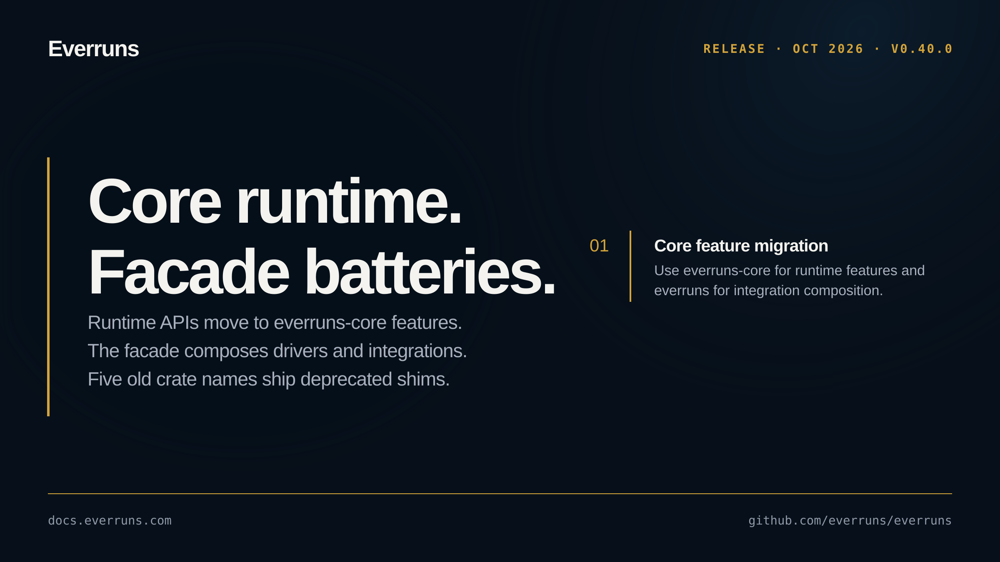

Everruns 0.40.0 is a maintenance release with fixes and internal changes and no user-facing entry of its own.

See the [GitHub release](https://github.com/everruns/everruns/releases/tag/v0.40.0) and the [full release notes](https://github.com/everruns/everruns/blob/main/CHANGELOG.md#0400---2026-10-04) for every pull request in this version.
