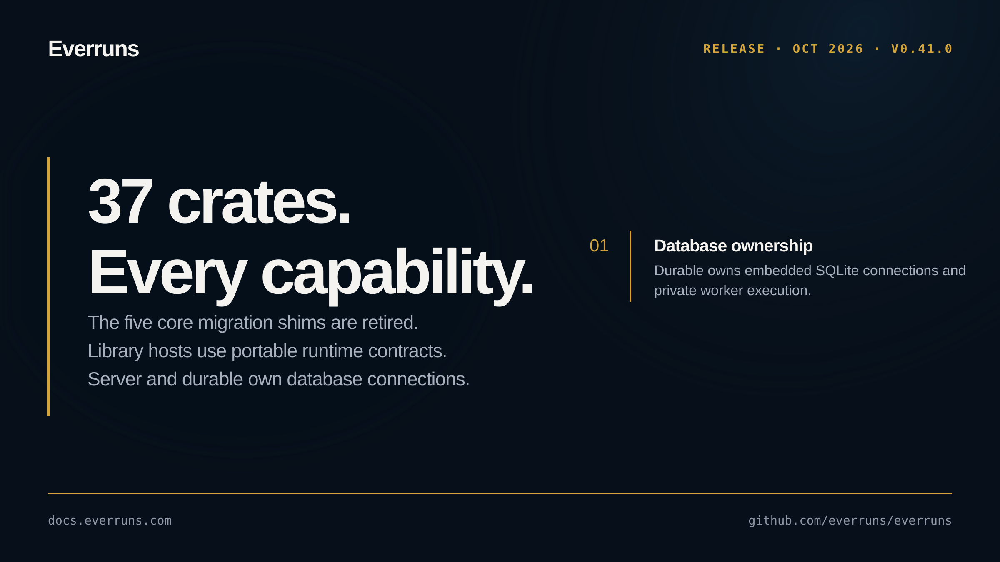

## In the changelog

- [Framework crates consolidated into everruns-core and the facade](/changelog/2026-10-04-framework-crates-consolidated/)

Before upgrading, read the breaking changes: [Framework crates consolidated into everruns-core and the facade](/changelog/2026-10-04-framework-crates-consolidated/).

See the [GitHub release](https://github.com/everruns/everruns/releases/tag/v0.41.0) and the [full release notes](https://github.com/everruns/everruns/blob/main/CHANGELOG.md#0410---2026-10-04) for every pull request in this version.
