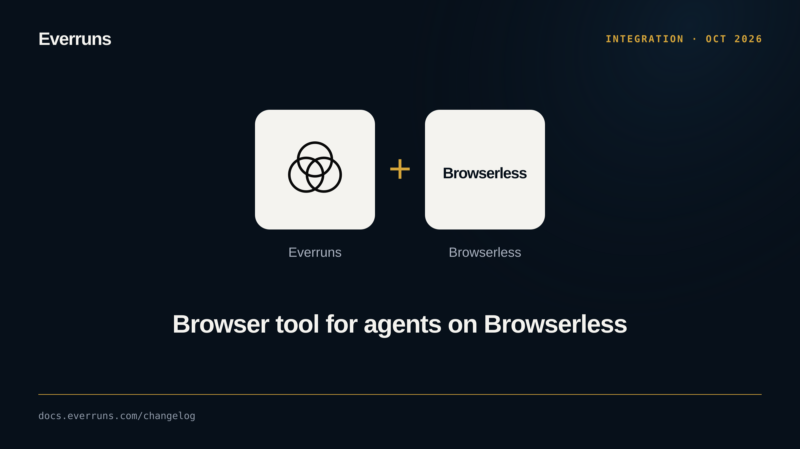

The `browser_use` capability gives an agent a `browser` tool on a Browserless
browser. Pages are read as an accessibility tree with element refs, and the
agent acts by ref or viewport coordinate, fills forms, finds text and works
across tabs. Traffic goes through the Everruns network guard.

On Claude models that support Anthropic's native browser toolset, the
capability uses it directly; set `native_tools: false` to keep the function
tool.

Browser use is experimental and ships behind the `browserless_browser_use`
feature flag.

See [Browser use](/capabilities/browser-use/) and [#4375](https://github.com/everruns/everruns/pull/4375), [#4376](https://github.com/everruns/everruns/pull/4376).
