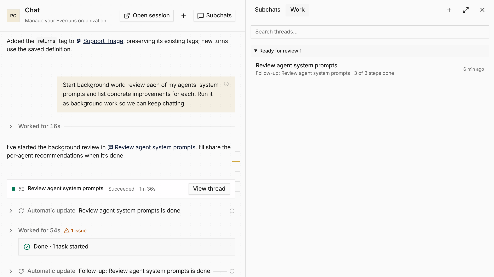

**In the UI:** with **Chat threads** turned on in **Settings → Features**,
Platform Chat can hand work to threads, which are child sessions. A **Threads**
button lists conversations and ongoing work, and background work shows its
progress, questions and failures. Custom agents use the same pattern through
the `coordination` capability.

**In code:** the Framework's `everruns::coordination` capability runs threads
as sessions of the same engine. Threads wake the coordinator with automatic
updates, and `coordination::threads` returns each thread's status, such as
`NeedsYou`, `Working` or `ReadyForReview`.

See [Chat and threads](/features/ui/#chat-and-threads),
[Coordination](/framework/coordination/) and [#4372](https://github.com/everruns/everruns/pull/4372), [#4377](https://github.com/everruns/everruns/pull/4377).
