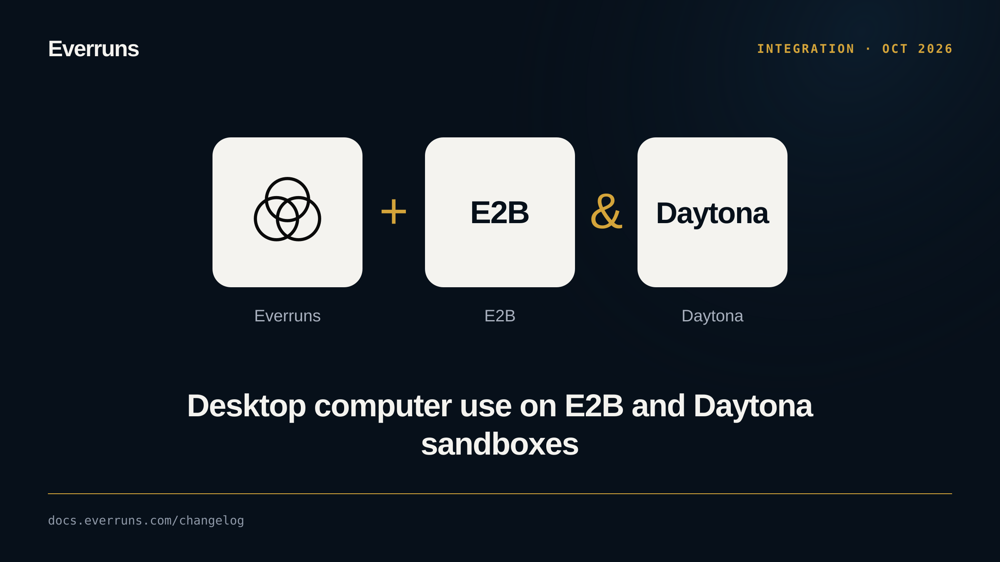

Agents can now operate a full Linux desktop instead of only a browser page. The
experimental `computer_use_desktop` capability runs the provider-neutral
`computer` tool on an E2B desktop sandbox, and `computer_use_daytona` runs it on
a Daytona sandbox through Daytona's Computer Use API. The session creates the
desktop on first use, keeps it between calls and deletes it when its lease ends.

The `computer` tool also gained zoom, cursor position, mouse button down and up,
hold-key and modified drag actions on Daytona, E2B and Browserless.

Connect E2B or Daytona first, then add one computer-use capability to the agent;
only one can provide the `computer` tool.

See [Computer use](/capabilities/computer-use/) and [#4244](https://github.com/everruns/everruns/pull/4244), [#4365](https://github.com/everruns/everruns/pull/4365), [#4367](https://github.com/everruns/everruns/pull/4367).
