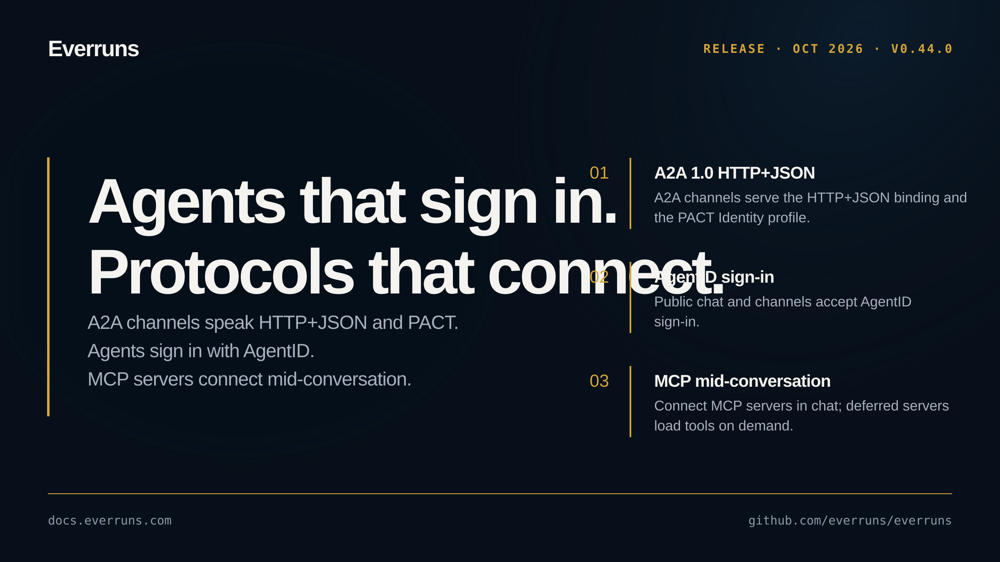

## Highlights

- **A2A 1.0 HTTP+JSON and PACT**: A2A channels serve the HTTP+JSON binding, the PACT Identity profile, and PACT Delegated sign-in, step-up and receipts ([#4322](https://github.com/everruns/everruns/pull/4322), [#4328](https://github.com/everruns/everruns/pull/4328), [#4350](https://github.com/everruns/everruns/pull/4350), [#4352](https://github.com/everruns/everruns/pull/4352))
- **AgentID sign-in**: Public chat and channels accept AgentID, and agents sign in with their AgentMail inbox ([#4334](https://github.com/everruns/everruns/pull/4334), [#4326](https://github.com/everruns/everruns/pull/4326), [#4337](https://github.com/everruns/everruns/pull/4337))
- **MCP in conversations**: Users manage their own MCP servers, connect them mid-conversation, and deferred servers load tools on demand ([#4315](https://github.com/everruns/everruns/pull/4315), [#4343](https://github.com/everruns/everruns/pull/4343), [#4345](https://github.com/everruns/everruns/pull/4345), [#4349](https://github.com/everruns/everruns/pull/4349))
- **Claude Haiku 5.5** and Daytona desktop computer use ([#4359](https://github.com/everruns/everruns/pull/4359), [#4365](https://github.com/everruns/everruns/pull/4365))

## In the changelog

- [Agent versions are retired in favor of change history](/changelog/2026-10-06-agent-versions-retired/)
- [A2A channels serve HTTP+JSON and the PACT profiles](/changelog/2026-10-07-a2a-http-json-and-pact/)
- [Sign in to channels and Public Chat with AgentID](/changelog/2026-10-07-agentid-sign-in/)
- [Claude Haiku 5.5 model added for Anthropic providers](/changelog/2026-10-07-claude-haiku-5-5/)

Before upgrading, read the breaking changes: [Agent versions are retired in favor of change history](/changelog/2026-10-06-agent-versions-retired/).

See the [GitHub release](https://github.com/everruns/everruns/releases/tag/v0.44.0) and the [full release notes](https://github.com/everruns/everruns/blob/main/CHANGELOG.md#0440---2026-10-08) for every pull request in this version.
