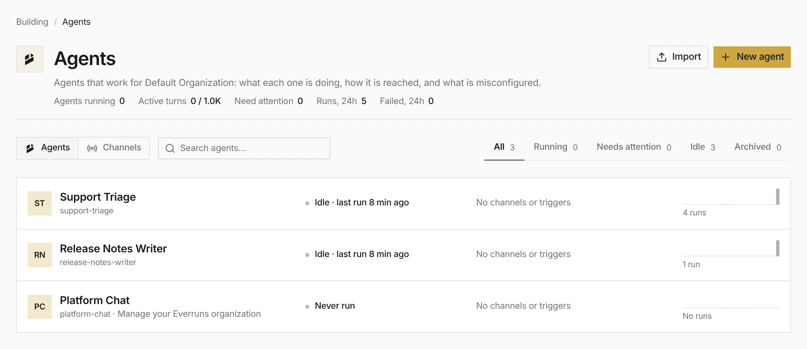

<video src="./agent-builder@2x.mp4" poster="./agent-builder-poster@2x.png" controls muted playsinline loop aria-label="Describing an agent on the New agent page, and the builder drafting it on the right"></video>

**In the UI:** the **Agents** page shows each agent's channels and triggers,
24-hour run bars and a **Needs attention** list for setup problems. Its
**Channels** view lists every channel in the organization with publish and
unpublish, people reached and fastest first reply. It replaces the Exposures
page; `/exposures` now redirects there.

**New agent** offers **Describe**, **Example**, **Blank** and **Import**.
Describe drafts the agent with the utility model, and **Create** makes the
agent with its draft channels and schedule trigger.

**In code:** `everruns agents draft` runs the same agent builder from the CLI.

See [Web UI](/features/ui/), [Channels](/features/channels/) and [#4399](https://github.com/everruns/everruns/pull/4399), [#4448](https://github.com/everruns/everruns/pull/4448), [#4457](https://github.com/everruns/everruns/pull/4457).
