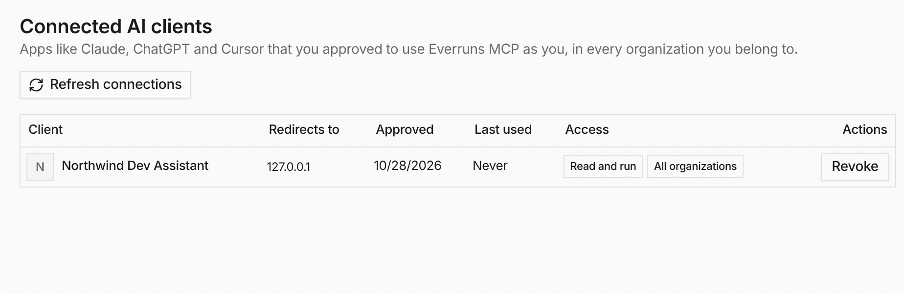

AI tools that connect to Everruns over MCP OAuth, such as a coding assistant
using the Everruns MCP server, now show up as connected clients.

**In the UI:** open **Settings → My agent experience** to see each client and
when it was last used, and revoke any you no longer use. Revoking deletes the
client's refresh tokens, and its next request is refused.

**In code:** `GET /v1/user/connected-clients` lists them and `DELETE` revokes
one. Every MCP request checks that its grant is still live.

See [Use Everruns in AI tools](/getting-started/use-in-ai-tools/) and [#4461](https://github.com/everruns/everruns/pull/4461).

## Update 2026-10-25

Connected AI clients are their own page, **Settings > AI clients**. See
[Personal settings pages](/changelog/2026-10-25-personal-settings-pages/).
