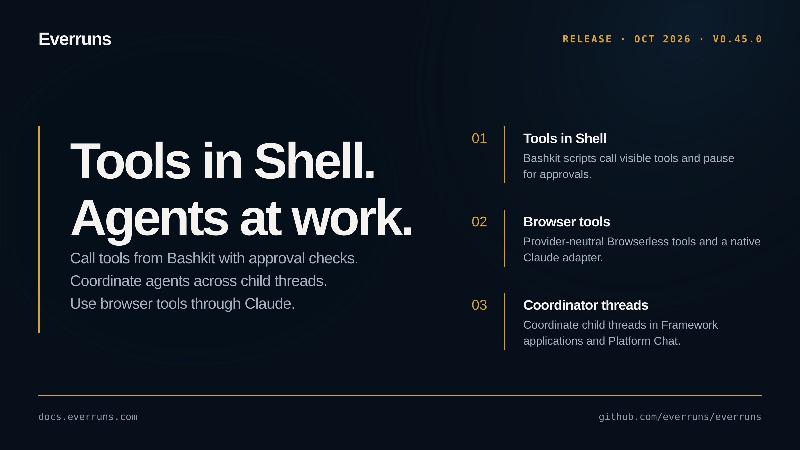

## Highlights

- **Tools in Shell**: Call visible tools from a Bashkit script, load deferred MCP servers, and pause for approvals before the script starts ([#4385](https://github.com/everruns/everruns/pull/4385), [#4386](https://github.com/everruns/everruns/pull/4386), [#4388](https://github.com/everruns/everruns/pull/4388)).
- **Browser tools**: Provider-neutral Browserless browser tools and a native Claude browser toolset adapter ([#4375](https://github.com/everruns/everruns/pull/4375), [#4376](https://github.com/everruns/everruns/pull/4376)).
- **Coordinator threads**: Coordinate child threads in Framework applications and Platform Chat ([#4377](https://github.com/everruns/everruns/pull/4377), [#4372](https://github.com/everruns/everruns/pull/4372)).

## In the changelog

- [Browser tool for agents on Browserless](/changelog/2026-10-08-browser-use-capability/)
- [Coordinator threads in Platform Chat and the Framework](/changelog/2026-10-08-coordinator-threads/)

See the [GitHub release](https://github.com/everruns/everruns/releases/tag/v0.45.0) and the [full release notes](https://github.com/everruns/everruns/blob/main/CHANGELOG.md#0450---2026-10-09) for every pull request in this version.
