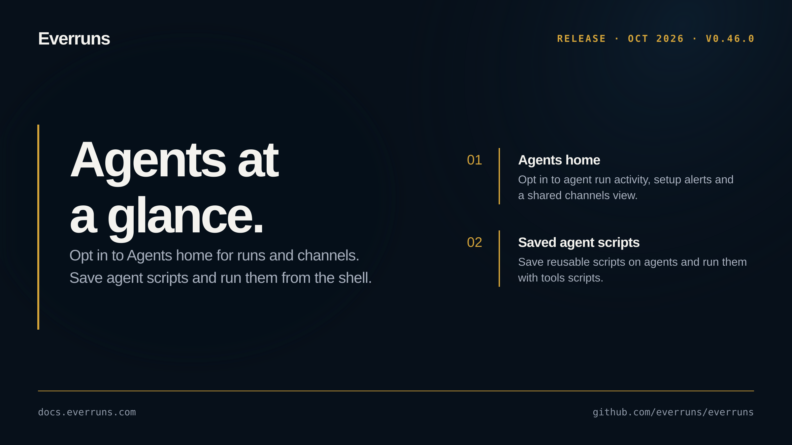

## Highlights

- **Agents home**: Enable the Agents home feature for run activity, setup alerts and a shared Channels view ([#4399](https://github.com/everruns/everruns/pull/4399)).
- **Agent scripts**: Save and manage reusable shell scripts on agents through the API, CLI and MCP, then run them with `tools scripts` using the caller's tools and identity ([#4390](https://github.com/everruns/everruns/pull/4390), [#4400](https://github.com/everruns/everruns/pull/4400)).

## In the changelog

- [Save shell scripts on agents and run them from triggers](/changelog/2026-10-09-agent-saved-scripts/)

See the [GitHub release](https://github.com/everruns/everruns/releases/tag/v0.46.0) and the [full release notes](https://github.com/everruns/everruns/blob/main/CHANGELOG.md#0460---2026-10-09) for every pull request in this version.
