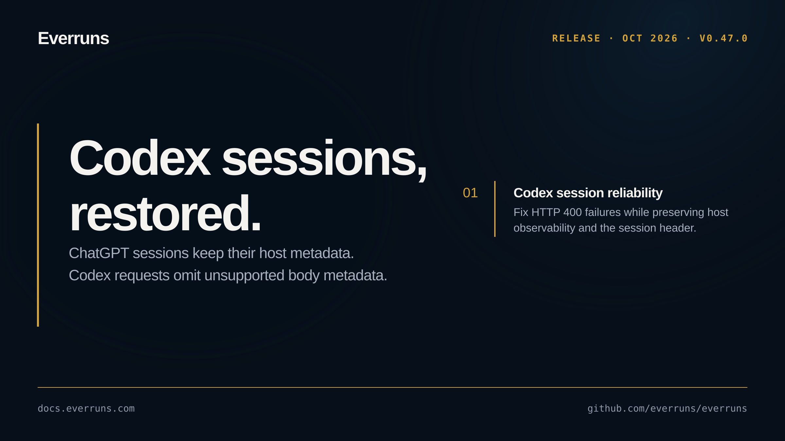

## Highlights

- **Codex session reliability**: Legacy Codex sessions keep host observability metadata and the session HTTP header while omitting unsupported request-body metadata, fixing ChatGPT sessions that failed with HTTP 400 ([#4464](https://github.com/everruns/everruns/pull/4464)).

## In the changelog

- [Agents home and a New agent page with an agent builder](/changelog/2026-10-09-agents-home-new-agent/)
- [Fix ChatGPT plan sessions failing with HTTP 400](/changelog/2026-10-09-chatgpt-plan-http-400-fix/)
- [See and revoke AI clients connected to Everruns](/changelog/2026-10-09-connected-ai-clients/)
- [Models and providers move into one registry page](/changelog/2026-10-09-models-providers-registry/)
- [Voice channels let people call an agent](/changelog/2026-10-09-voice-channels/)

See the [GitHub release](https://github.com/everruns/everruns/releases/tag/v0.47.0) and the [full release notes](https://github.com/everruns/everruns/blob/main/CHANGELOG.md#0470---2026-10-09) for every pull request in this version.
