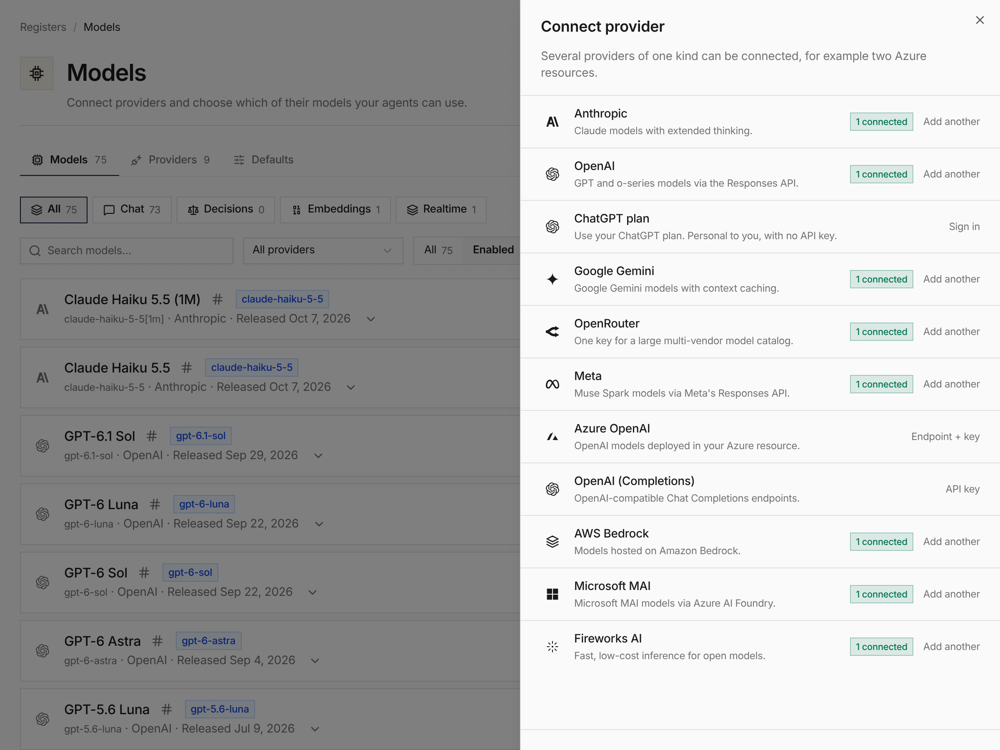

Providers moved out of Settings into **Registries → Models**, which has three
tabs. **Models** lists every model from every connected provider and flags new
ones a sync discovered for review. **Providers** connects a provider in one
sheet: driver, name and key, then the models to enable, with recommended ones
ticked. **Defaults** sets the organization's default model, decision model and
default providers per service.

Provider names are now unique within an organization. Managing providers and
models needs the `org:models:manage` permission, which replaces the separate
provider permission.

See [Models](/features/ui/#models), [Providers](/providers/) and [#4458](https://github.com/everruns/everruns/pull/4458).
