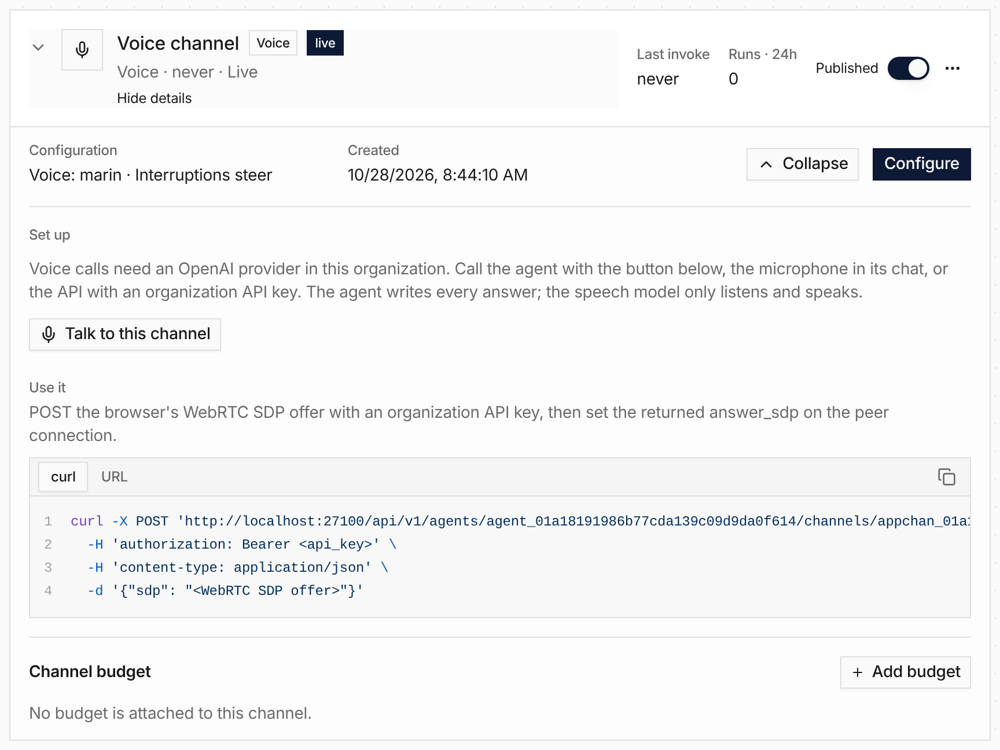

Voice is a channel for WebRTC calls. The agent keeps its model, tools and
instructions; speech streams sentence by sentence, and interruptions stop
playback. Calls and text chats share a transcript.

**In the UI:** an administrator enables **Voice** in **Settings → Features**,
then adds a channel from the agent's **Integrations** tab.

**In code:** `everruns::voice` adds calls to Framework sessions; serve's `voice`
feature exposes browser calls for top-level agents.

Cascaded OpenAI speech defaults to `gpt-realtime-2.1-mini` over Realtime,
preserving 24 kHz PCM. Explicit Speech API overrides retain their transport
until [retirement on January 6, 2027](https://developers.openai.com/api/docs/guides/text-to-speech).
Exact-text instructions express intent; generative speech is not guaranteed
verbatim.

See [Voice](/features/voice/), [Framework voice](/framework/voice/) and
[#4394](https://github.com/everruns/everruns/pull/4394),
[#4402](https://github.com/everruns/everruns/pull/4402),
[#4406](https://github.com/everruns/everruns/pull/4406).
