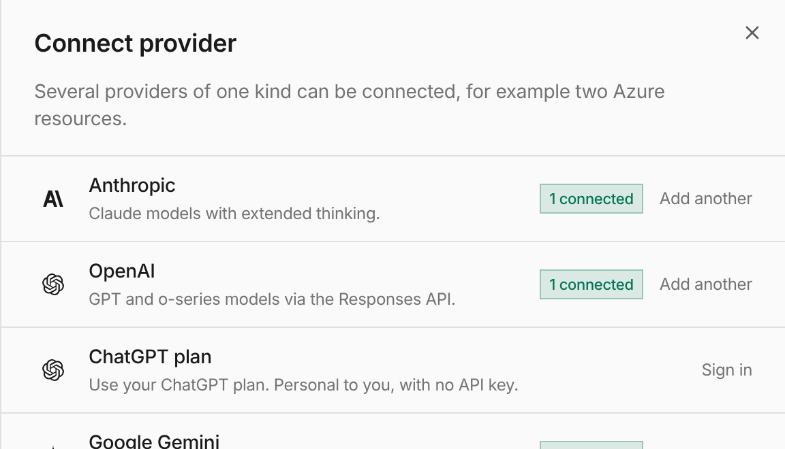

Connecting a personal ChatGPT plan used to depend on an organization feature
flag that hosted deployments kept off. The flag is gone: connecting the
provider is the opt-in, and each connection already belongs only to the user
who signs in.

Open **Models → Providers → Connect provider → ChatGPT → Sign in with ChatGPT**,
approve plan use in ChatGPT, then pick a discovered model in the chat model
picker. The composer shows **Using your ChatGPT plan**. Other users, shared
defaults and Playground cannot use your connection.

See [ChatGPT plan](/features/chatgpt/) and [#4329](https://github.com/everruns/everruns/pull/4329), [#4547](https://github.com/everruns/everruns/pull/4547).
