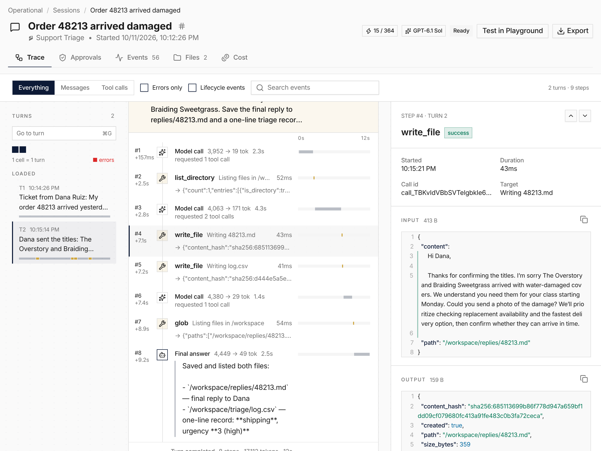

**In the UI:** a session now opens on **Trace**, which replaces the Transcript
and Timeline tabs. A turn rail with a minimap leads to each turn's steps: model
calls, tool calls, approvals, sub-agents and messages, with waterfall timing
bars. The step inspector shows input, output, the full model request and raw
events. Batches and sub-agents expand inline, search jumps to a hit, and `j`
and `k` move between steps. The view, error filter and selected step live in
the URL.

**In code:** read the same data from `/v1/sessions/{id}/trace`, or with
`everruns sessions trace get` and `everruns sessions trace turns list`.

See [Web UI](/features/ui/#sessions), the [sessions CLI reference](/reference/cli/sessions/)
and [#4481](https://github.com/everruns/everruns/pull/4481), [#4500](https://github.com/everruns/everruns/pull/4500), [#4503](https://github.com/everruns/everruns/pull/4503), [#4556](https://github.com/everruns/everruns/pull/4556).
