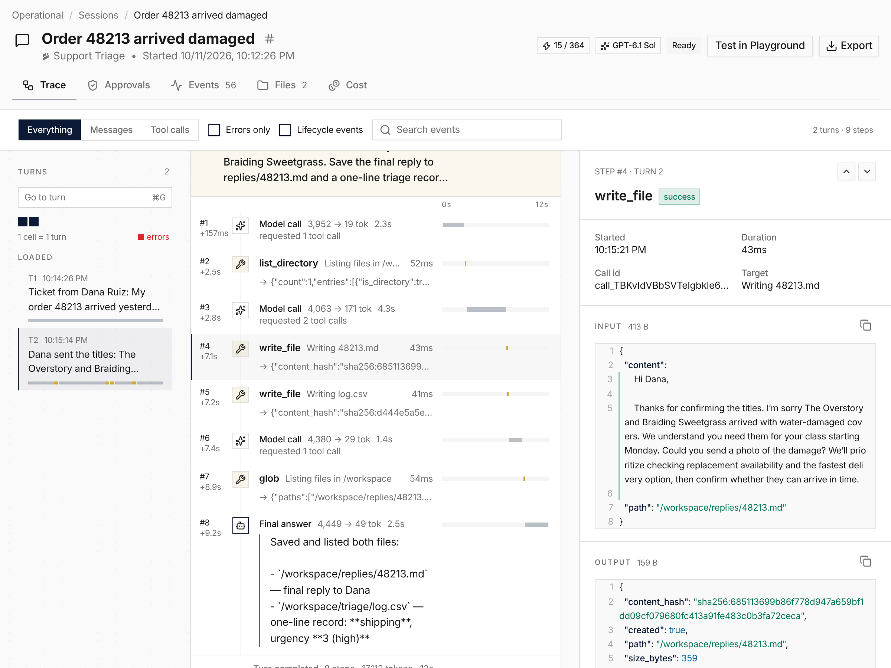

**In the [UI](/features/ui/#sessions):** a session now opens on **Trace**, which replaces the Transcript
and Timeline tabs. A turn rail with a minimap leads to each turn's steps: model
calls, tool calls, approvals, sub-agents and messages, with waterfall timing
bars. The step inspector shows input, output, the full model request and raw
events. Batches and sub-agents expand inline, search jumps to a hit, and `j`
and `k` move between steps. The view, error filter and selected step live in
the URL.

**In code:** read the same data from `/v1/sessions/{id}/trace`, or with
[`everruns sessions trace get`](/reference/cli/sessions/) and `everruns sessions trace turns list`.

## Update 2026-11-20

Open a message or the tools list straight from the step inspector. The model
request opens in a near-full-screen modal with image previews and file downloads
for attachments retained in the trace. **View full message** opens the
original turn input in the sidebar.
