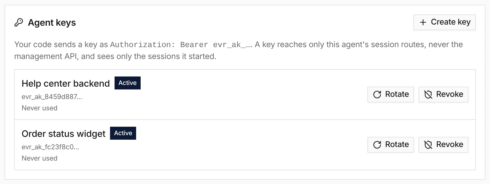

**In the UI:** add an **Agent API** channel to an agent, publish it, and create a
key in its **Agent keys** card. The secret (`evr_ak_…`) is shown once. An
application holding it can call this one agent and nothing else; keys rotate
with an overlap window and can be revoked.

**In code:** routes under `/v1/channels/{channel_id}` start sessions, send
messages, follow events over SSE, answer questions, approve tools and cancel
turns. A key sees only the sessions it started. Channel settings add end users
through your own identity provider, browser origins, `Idempotency-Key` retries,
a daily spend limit per caller, and access for organization members.

See [Call your agent from code](/how-to/call-your-agent-from-code/),
[Agent API](/features/agent-api/) and [#4438](https://github.com/everruns/everruns/pull/4438), [#4490](https://github.com/everruns/everruns/pull/4490), [#4508](https://github.com/everruns/everruns/pull/4508), [#4511](https://github.com/everruns/everruns/pull/4511), [#4514](https://github.com/everruns/everruns/pull/4514), [#4516](https://github.com/everruns/everruns/pull/4516).
