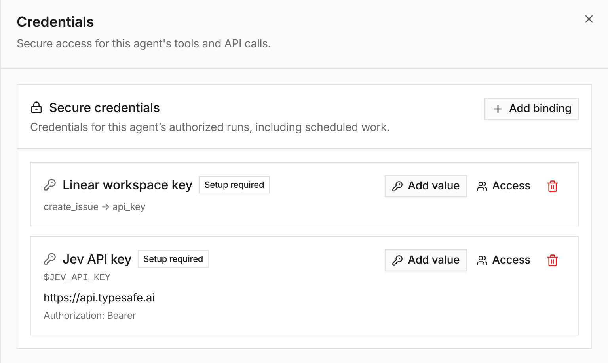

**In the UI:** on an agent's **Credentials** tab, **Add binding** now offers
**HTTP API**: a shell variable, the HTTPS URL it may be sent to, and whether it
goes as a bearer token or a named header. With outbound HTTP on, the agent's
shell calls the API with `$NAME`. The platform swaps the real key into that
header only for requests to the bound URL and redacts it if a response echoes
it back.

**In the API:** [session secrets](/capabilities/session-storage/) accept `bindings` on
`PUT /v1/sessions/{session_id}/storage/secrets`, and the MCP tool
`session_set_secret` takes `url`, `auth` and `scope`, collecting the value on a
secure page.

See [Bashkit Shell](/capabilities/bashkit-shell/#api-keys-the-agent-never-sees).

## Update 2026-10-19

[Scoped credentials](/changelog/2026-10-19-scoped-credentials-secure-capture/) add virtual-user and organization ownership, explicit agent grants, form-field bindings and Web Fetch response capture. Hosted Bashkit resolves authorization again for each credential-bearing send. Secure value updates now require the observed resource revision; ordinary unbound session secrets retain their existing lifecycle.
