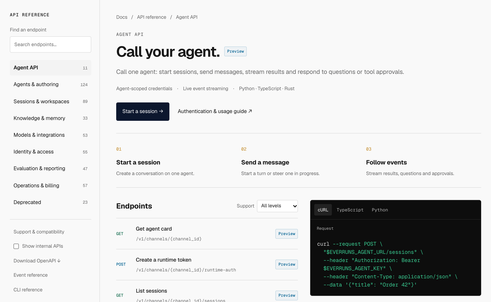

The API reference starts with the [Agent API](/features/agent-api/) and groups
management endpoints by domain. Each endpoint places request and response
examples beside its schemas, with language and status-code pickers.

Support labels distinguish Preview and Experimental APIs. Internal operator
routes are available through **Show internal APIs**. Deprecated routes remain
reachable and point to a replacement when one exists; an unannounced removal
date stays unannounced.

Search finds endpoints by name, path or operation ID. Existing reference URLs
remain valid, and group pages appear in the sitemap and as Markdown for agents.
Duplicate operation IDs no longer hide distinct endpoints. Grouping, support
and migration guidance are generated from OpenAPI.

