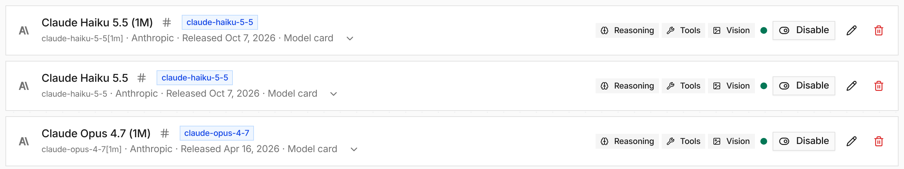

Each model on the **Models** page now shows a **Model card** link next to its release date when
the vendor has published one: Anthropic's system cards for Claude, OpenAI's system cards for
GPT-6 and GPT-5.6, and Meta's card for Muse Wonder. The card is where the vendor documents
evaluations, safety testing and known limits.

The same link is in the model profile the API returns:

```json
{
  "name": "Muse Wonder",
  "family": "muse-wonder",
  "model_card_url": "https://research.meta.ai/static/muse-wonder-model-card"
}
```

Models without a published card carry no link.

See [Providers](/providers/). [#4645](https://github.com/everruns/everruns/pull/4645)
