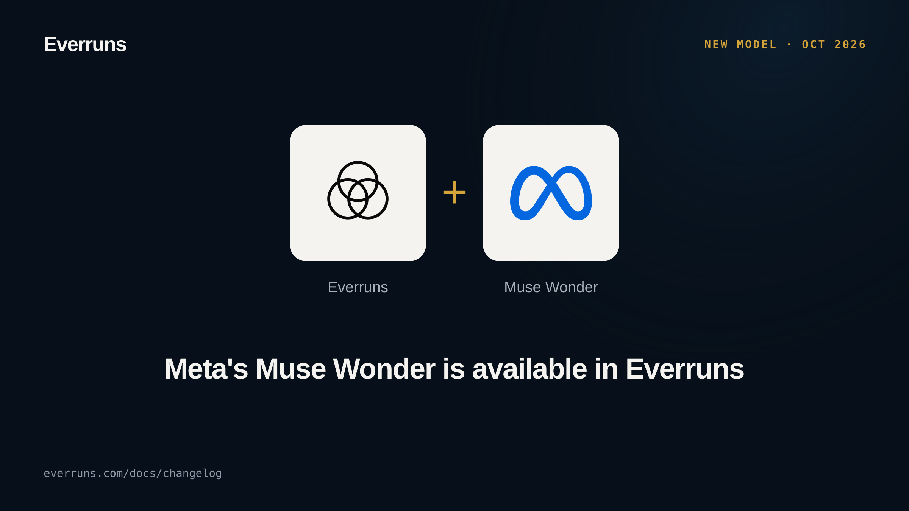

Meta shipped **Muse Wonder** (`muse-wonder-1.0`, preview) today, and you can put it to work in
Everruns right away. Wonder is built for the long jobs: extended agent runs, changes that span
many files, and orchestrating sub-agents. It reads 1,048,576 tokens of
context plus images, audio, video and PDFs. It costs $4.00 input, $0.20 cached and $20.00 output per
million tokens. Add a [Meta](/providers/meta/) provider, sync models, and Wonder shows up with a
link to Meta's model card.

Want it to think harder? Every Muse model now has a reasoning effort picker, Minimal through Max (Muse Spark 1.2 stops at
Extra High). Set it per message:

```bash
curl -X POST http://localhost:9300/api/v1/sessions/{session_id}/messages \
  -H "Authorization: Bearer $EVERRUNS_TOKEN" \
  -H "Content-Type: application/json" \
  -d '{"message": {"role": "user", "content": [{"type": "text", "text": "Plan the move of our billing service to the new ledger"}]},
       "controls": {"reasoning": {"effort": "max"}}}'
```
